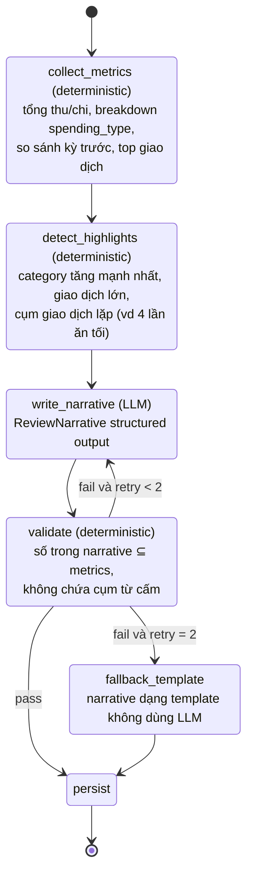
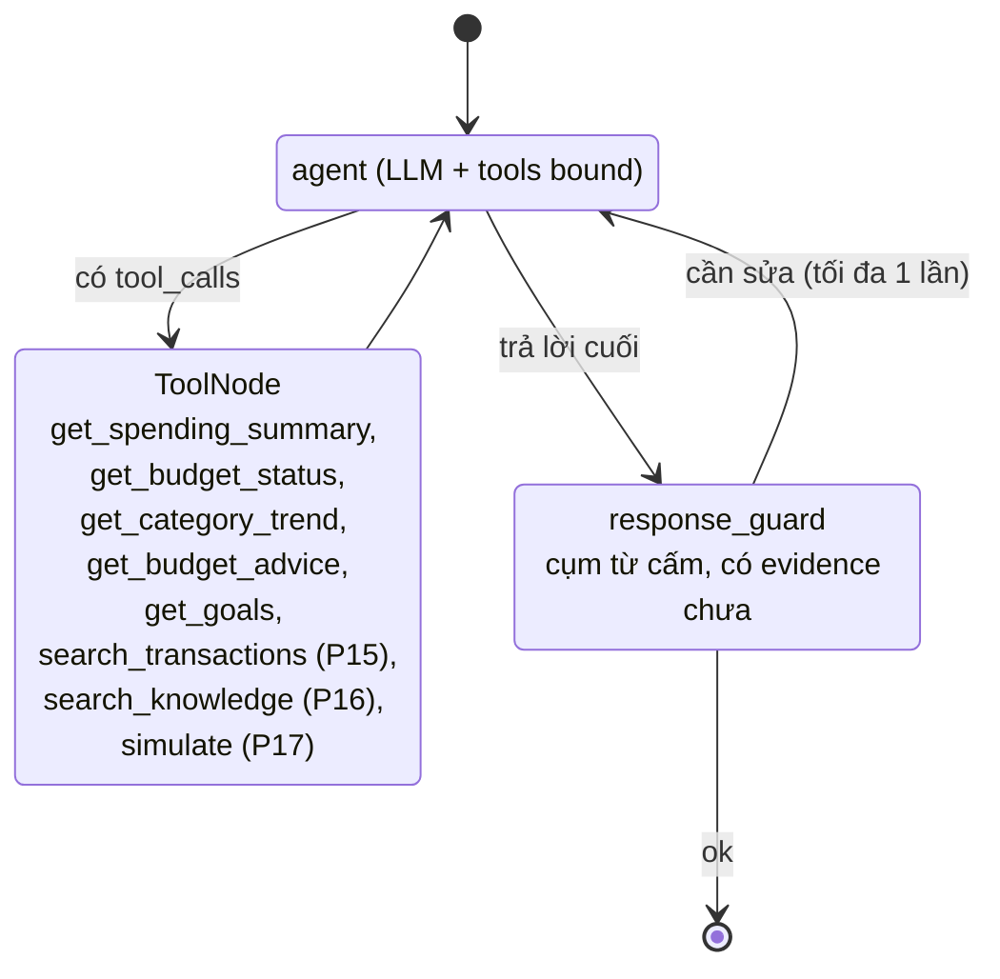
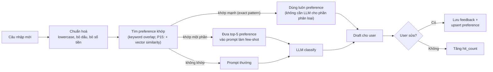

# AI Architecture

## 1. Bản đồ tác vụ AI

| Tác vụ | Phase | Kỹ thuật | Model mặc định | Output |
|---|---|---|---|---|
| Parse câu nhập giao dịch | 2 | Structured Outputs (Pydantic → JSON schema) | `gpt-4o-mini` | `TransactionDraft` |
| Phân loại category × spending_type | 2, 3 | Structured Outputs + few-shot từ `classification_preference` | `gpt-4o-mini` | `ClassificationSuggestion` (kèm `confidence`, `reason`) |
| Weekly / Monthly review narrative | 6, 7 | LangGraph workflow, input là metrics đã tính sẵn | `gpt-4o` | `ReviewNarrative` |
| Giải thích Budget advice | 8 | Structured Outputs, input là `evidence` deterministic | `gpt-4o-mini` | `explanation` |
| Financial Coach | 10, 16 | LangGraph ReAct agent + function calling (LangChain tools) | `gpt-4o` | Chat message + tool calls |
| Đọc hoá đơn | 13 | Vision input + Structured Outputs | `gpt-4o` | `ReceiptExtraction` |
| Phân loại hàng loạt khi import | 14 | Batch classify (gom 20 dòng / request) | `gpt-4o-mini` | `list[ClassificationSuggestion]` |
| Embedding giao dịch | 15 | `text-embedding-3-small` (1536 dim) | — | vector |
| RAG kiến thức tài chính | 16 | Chunk + embed + pgvector similarity + trích nguồn | `gpt-4o` | Câu trả lời có citation |
| Diễn giải What-if | 17 | Structured Outputs trên kết quả mô phỏng | `gpt-4o-mini` | Narrative |

Tên model đọc từ env (`OPENAI_MODEL_FAST`, `OPENAI_MODEL_SMART`) — không hard-code.

## 2. Nguyên tắc nội dung (áp dụng mọi prompt sinh văn bản)

1. **3 tầng:** Observation (số liệu) → Explanation (nguyên nhân, dựa trên dữ liệu) → Action (gợi ý, có điều kiện "nếu bạn muốn...").
2. **Không phán xét:** cấm các cụm như "bạn tiêu quá nhiều", "lãng phí", "bạn phải", "bạn nên ngay lập tức". Dùng "cao hơn tháng trước X%", "phần lớn mức tăng đến từ...", "bạn có thể cân nhắc...".
3. **Không bịa số:** mọi con số trong output phải có trong input metrics. Kiểm tra tự động: trích số từ narrative và đối chiếu với metrics (golden test).
4. **AI không quyết định thay user:** luôn trả draft/gợi ý, user xác nhận.
5. Ngôn ngữ: tiếng Việt, xưng "bạn".

Prompt lưu ở `backend/app/ai/prompts/*.md` (có version trong tên hoặc header), không inline dài trong code.

## 3. Structured output chính (phác thảo)

```python
class TransactionDraft(BaseModel):
    direction: Literal["income", "expense"]
    amount: int                      # đồng, > 0
    occurred_on: date | None         # None = hôm nay
    note: str
    category_slug: str               # phải thuộc danh sách category gửi kèm
    spending_type: Literal["essential", "non_essential", "irregular"] | None
    confidence: float                # 0..1
    reason: str                      # vì sao chọn category/type

class ReviewNarrative(BaseModel):
    observation: str                 # What happened?
    explanation: str                 # Why?
    notice: list[str]                # What should you notice? (1-3 ý)
    action: str | None               # gợi ý có điều kiện, không ra lệnh
    reflection_question: str         # câu hỏi cho user
```

## 4. LangGraph — Review graph (Phase 6, 7)

Cùng một graph, tham số `period = week | month`.



## 5. LangGraph — Financial Coach graph (Phase 10, 16)



- Tools **chỉ đọc** (read-only). Coach không tạo/sửa giao dịch hay budget; nếu user muốn, Coach trả về link/gợi ý tới màn hình tương ứng.
- Giới hạn tối đa 6 vòng tool call / câu hỏi.
- Lịch sử chat lưu `chat_session` / `chat_message`.

## 6. Classification memory (Phase 3)



## 7. Đánh giá chất lượng AI (golden tests)

- Thư mục `backend/tests/ai_golden/` chứa file YAML/JSON test cases cố định cho từng tác vụ.
- Chạy: `pytest -m ai` (cần `OPENAI_API_KEY`); mặc định CI/local `pytest` bỏ qua.
- Mỗi phase AI định nghĩa ngưỡng pass (ví dụ NL parse: amount đúng 100%, direction đúng 100%, category đúng >= 80%).
- Khi sửa prompt: chạy lại golden test, ghi kết quả vào Handoff notes của phase.
