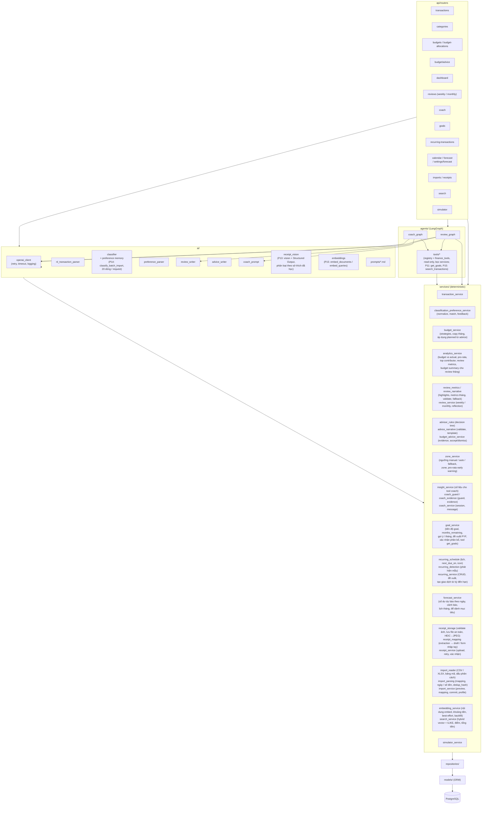

# Backend Components

## Sơ đồ module

## Quy tắc phụ thuộc (bắt buộc)

| Từ | Được gọi | Không được gọi |
|---|---|---|
| `api/routers` | `services`, `ai`, `agents`, `schemas` | `repositories` trực tiếp (trừ CRUD rất đơn giản) |
| `services` | `repositories`, `services` khác | `ai`, `agents`, OpenAI SDK |
| `ai` | `openai_client`, `services` (đọc context), `schemas` | ghi DB trực tiếp |
| `agents` | `agents/tools`, `services`, `ai` (writer/prompt), `openai_client` | `repositories` trực tiếp |
| `agents/tools` | `services` | — |
| `repositories` | `models` | `services` |

Hệ quả: toàn bộ `services/` test được **không cần OpenAI key**. Test AI tách riêng ở `tests/ai_golden/` (đánh dấu `@pytest.mark.ai`, skip khi không có key).

## Mẫu xử lý lỗi & AI

- `openai_client` bọc mọi lời gọi: timeout, retry có backoff (tối đa 2 lần) cho lỗi mạng/429, validate structured output bằng Pydantic; nếu validate fail → retry 1 lần kèm thông báo lỗi, sau đó trả lỗi `AIUnavailable` rõ ràng.
- Router trả `503` + message thân thiện khi AI lỗi; tính năng deterministic vẫn chạy bình thường.
- Mã lỗi AI (`AIUnavailable`, kế thừa `DomainError`, cùng format `{"detail","code"}`): `503 AI_NOT_CONFIGURED` (thiếu `OPENAI_API_KEY`, không gọi mạng), `503 AI_AUTH_FAILED` (key sai/không có quyền), `503 AI_RATE_LIMITED`, `503 AI_TIMEOUT`, `503 AI_UNAVAILABLE` (mạng/5xx), `502 AI_INVALID_OUTPUT` (output vẫn sai sau khi cho model sửa 1 lần, hoặc model từ chối).
- Structured output dùng Chat Completions `response_format=json_schema` (strict) sinh từ Pydantic (bỏ keyword strict mode không hỗ trợ như `maxLength`, `default`), `temperature=0`. Seam để test: `openai_client._chat_json` (monkeypatch trả JSON giả).
- Log mỗi lời gọi AI: tác vụ, model, token, latency (không log API key).
- Budget advice (Phase 8): router `budget_advice` gọi `budget_advice_service.prepare_advice` (verdict + evidence deterministic) → `ai/advice_writer.write_explanations` (chỉ viết văn bản; AI lỗi / output sai → template, **không** trả 503) → `budget_advice_service.save_advice`. Thay đổi ngân sách chỉ qua `POST /budget/advice/{id}/accept` với `confirm: true` → `budget_service`.
- Flexible zones (Phase 9): **không có AI**. `zone_service` (phụ thuộc `budget_service` + repositories) tính ngưỡng và zone; `analytics_service` gắn `zone` vào từng dòng Budget vs Actual và dựng `GET /budgets/{id}/zones`; `budget_advice_service` đọc `comfort_high` đã lưu + `zone_service.zone_evidence` cho advisor. `budget_service` không import `zone_service` (tránh vòng) — chỉ giữ / xoá cột vùng khi ghi lại dòng phân bổ.
- Financial Coach (Phase 10): router `coach` → `coach_service.send_message(db, session_id, data, runner)` — service lưu user message (commit) → gọi `runner` do router truyền vào (`agents/coach_graph.run_coach`, vì `services` không được import `agents`) → lưu assistant message (tool trace, evidence, metadata). `coach_graph` dùng `agents/tools/finance_tools` (5 tool read-only, chỉ gọi `services/insight_service`) + `ai/openai_client.chat_with_tools` + `ai/coach_prompt`; `response_guard` / evidence là deterministic ở `services/coach_guard`, `services/coach_evidence`; token/chi phí ở `core/ai_usage`. AI lỗi → 503 (câu hỏi vẫn lưu); câu hỏi ngoài phạm vi / yêu cầu ghi → template, không gọi AI. Coach không ghi bảng nghiệp vụ nào.
- Goals + Pay Yourself First (Phase 11): **không có AI**. Router `goals` → `goal_service` (phụ thuộc `goal_repository`, `budget_repository`; không import `budget_service`). `current_amount` luôn = tổng `goal_contributions` (không có cột riêng). Đề xuất PYF (`POST /goals/pyf-proposal`, và `pyf_proposal` trong response `POST /transactions` — router `transactions` gọi `goal_service.proposal_for_new_income` sau khi tạo) chỉ đọc; chỉ `POST /goals/allocations` (user xác nhận) ghi `goal_contributions` trong 1 commit (lỗi → không ghi gì). `transaction_service` đọc `goal_repository` để chặn đổi thu nhập đã cấp tiền cho goal thành khoản chi (409) hoặc giảm dưới tổng đã phân bổ (422). Tool Coach `get_goals` (`agents/tools/finance_tools`) gọi `goal_service.get_goals_overview` (chỉ đọc).
- Calendar & cashflow forecast (Phase 12): **không có AI**. Router `recurring_transactions` → `recurring_service` (phụ thuộc `transaction_service.resolve_category/resolve_spending_type`, `recurring_repository`, `app_setting_repository`; lịch thuần ở `recurring_schedule`, phát hiện thuần ở `recurring_detection`). Phát hiện (`POST …/detect`) chỉ ghi danh sách **đề xuất** vào `app_settings.recurring.suggestions`; khoản định kỳ chỉ được tạo khi user xác nhận (`…/suggestions/{id}/confirm`, 1 commit: tạo + gắn giao dịch lịch sử). "Tạo giao dịch" (`…/{id}/create-transaction`) ghi giao dịch `source='recurring'` + tiến `next_due_on` 1 kỳ trong 1 commit; router gọi thêm `goal_service.proposal_for_new_income` (đề xuất PYF, không ghi). Router `forecast` → `forecast_service` (phụ thuộc `recurring_service`, `goal_service.compute_progress`, `goal_repository`, `transaction_repository`, `app_setting_repository`): `GET /forecast`, `GET /calendar/month`, `GET/PATCH /settings/forecast`. Hàm thuần `project_balance`, `goal_saving_schedule`, `variable_average` có unit test với số VND cụ thể. Chưa đăng ký tool Coach `get_cashflow_forecast` (schema `ForecastOutput` sẵn sàng).
- Receipt OCR (Phase 13): router `receipts` → `receipt_service.upload_receipt / retry_receipt(db, …, analyzer)` — `analyzer` là closure router truyền vào gọi `ai/receipt_vision.analyze` (vì `services` không import `ai`, giống `runner` của Coach). Service: `receipt_storage.validate_image` (content type + đuôi + ≤ 10MB + magic bytes; 415 `unsupported_file_type` / 413 `file_too_large`) → lưu file `UPLOAD_DIR/receipts/YYYY/MM/{id}.ext` → receipt `uploaded` (commit) → `receipt_storage.vision_payload` (HEIC/HEIF → JPEG bằng Pillow + pillow-heif) → `analyzer` (trả `ReceiptAnalysis`, **không raise** lỗi AI) → `receipt_mapping.assess_extraction` / `build_draft` / `build_manual_prefill` (hàm thuần) → `extracted` hoặc `failed` (commit). AI lỗi / chưa cấu hình không làm hỏng upload: receipt `failed` + form nhập tay, response vẫn 201. `receipt_vision` chỉ gửi ảnh + prompt + bảng danh mục chi (không gửi lịch sử giao dịch), dùng `openai_client.structured_completion` (`OPENAI_MODEL_SMART`, timeout 60s, validate slug / total → model sửa 1 lần) rồi `classifier.match_preference` theo **tên cửa hàng**. Giao dịch chỉ được tạo ở `POST /receipts/{id}/confirm` → `receipt_service.confirm_receipt` (dùng `transaction_service.resolve_category/resolve_spending_type`, `transaction_repository.add`, `classification_preference_service.record_feedback(keyword=tên cửa hàng, guess_keyword=False)`; 1 commit: giao dịch `source='receipt'` + `receipt_id` + receipt `confirmed`); router gọi thêm `goal_service.proposal_for_new_income`. `GET /receipts/{id}/file` trả ảnh (HEIC đổi sang JPEG để xem trước). Log chỉ có receipt id / mime / size / status / model / token — không log ảnh hay base64.
- CSV / Excel import (Phase 14): router `imports` → `import_service.preview_import / update_mapping(db, …, classifier)` — `classifier` là closure router truyền vào gọi `ai/classifier.classify_batch_import` (như `analyzer` Phase 13). Service: `import_reader.read_table` (đuôi `.csv` / `.xlsx` + content type + ≤ 10MB + zip / không NUL; `utf-8-sig` → `cp1258`; đoán `,` `;` tab; `pandas` + `openpyxl`; ≤ 5.000 dòng; 413 / 415 / 422) → `import_parsing` (hàm thuần: dòng tiêu đề, `guess_mapping` hoặc `import_mapping_profiles` đã lưu, `parse_rows` → chuẩn hoá ngày / số tiền / chiều, `dedup_hash`, trùng trong file) → `transaction_repository.existing_dedup_hashes` (trùng với giao dịch đã import) + `non_import_keys_between` (cảnh báo trùng nhập tay) → `classifier` cho dòng hợp lệ (nội dung đã che số dài; không raise lỗi AI — thiếu đề xuất → `other` / `other_income`, confidence 0) → lưu `import_batches` (`previewed`, bảng thô + dòng preview trong JSONB; commit). **Không tạo giao dịch** ở preview / đổi mapping. `POST /imports/{id}/commit` → `import_service.commit_import`: kiểm tra mọi dòng đã chọn (`transaction_service.resolve_category/resolve_spending_type`) rồi mới ghi; giao dịch `source='import'` + `import_batch_id` + `dedup_hash`; giữ đề xuất từ sở thích → `classification_preference_service.record_feedback` (hit_count), sửa đề xuất → chỉ `classification_feedback` (không học sở thích mới); batch `committed`; upsert mapping profile — **1 commit**, lỗi → rollback, unique `dedup_hash` vi phạm → 409 `import_conflict`. File đã commit → 409 `IMPORT_ALREADY_COMMITTED` (body kèm `import_batch_id` qua `DomainError.extra`).

- Semantic search (Phase 15): router `search` → `search_service.search_transactions(db, q, embedder, …)` — `embedder` = `ai/embeddings.embed_queries` (router / `coach_graph` truyền vào, `services` không import `ai`). `ai/embeddings` bọc `openai_client.create_embeddings` (`OPENAI_EMBEDDING_MODEL`, chia lô 100, timeout 15s, retry SDK, log task / số input / token / latency; seam test `openai_client._embed_raw`). Service: embed `"Chi tiêu {q}"` → `embedding_repository.vector_candidates` (top `limit × 5`, cosine `<=>`, HNSW, lọc ngày) ∪ `keyword_candidates` (ghi chú / tên danh mục ILIKE cả cụm + từ ≥ 3 ký tự, escape `%` `_`) → điểm `0.75 × (1 − distance) + 0.25 × keyword_boost` (1 = ghi chú chứa cụm, 0.5 = tên danh mục chứa cụm, còn lại 0.5 × tỉ lệ từ khoá có trong ghi chú; so khớp bỏ dấu) → bỏ dòng chỉ khớp ngữ nghĩa < 0.3 → tổng thu / chi bằng Python. Embed khi ghi: `api/embedding_hook.index_transactions / index_import_batch` (gọi **sau** khi dựng response) → `embedding_service.embed_transactions_best_effort` (không bao giờ raise; rollback + log). `embedding_service.backfill` dùng chung cho script `backfill_embeddings` và `POST /search/transactions/reindex`. Tool Coach `search_transactions` (`finance_tools.search_transactions_tool` → `search_service.search_for_coach`, dùng `CoachToolContext.embedder`).

## API conventions

- Prefix `/api/v1`. JSON, `snake_case`.
- Tiền trả về dạng số nguyên (đồng). Frontend format.
- Ngày dạng ISO `YYYY-MM-DD`.
- Lỗi: `{"detail": "...", "code": "..."}` (`app/core/errors.py`: `DomainError` → 422, `NotFoundError` → 404, `ConflictError` → 409 — vd. tháng đã có budget). Lỗi validate request giữ `detail` dạng danh sách của FastAPI, `code = "validation_error"`.
- PATCH: chỉ field được gửi mới cập nhật; field không cho sửa / không tồn tại → 422 (`extra="forbid"`).
- Danh sách có phân trang trả `{items, total, page, page_size}`.
- Endpoint AI trả **draft**, không ghi DB; ghi DB qua endpoint CRUD thường sau khi user xác nhận.
