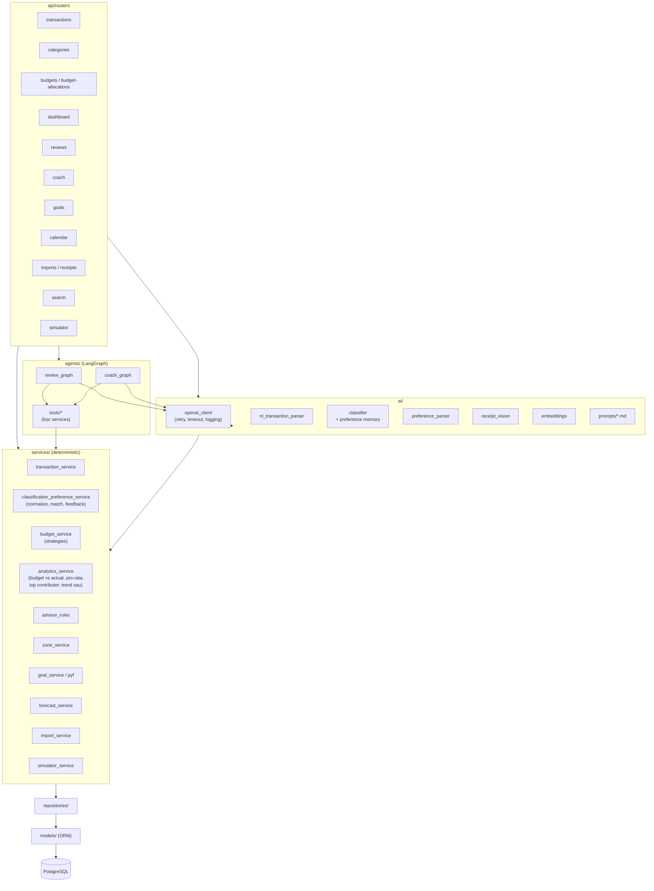

# Backend Components

## Sơ đồ module

## Quy tắc phụ thuộc (bắt buộc)

| Từ | Được gọi | Không được gọi |
|---|---|---|
| `api/routers` | `services`, `ai`, `agents`, `schemas` | `repositories` trực tiếp (trừ CRUD rất đơn giản) |
| `services` | `repositories`, `services` khác | `ai`, `agents`, OpenAI SDK |
| `ai` | `openai_client`, `services` (đọc context), `schemas` | ghi DB trực tiếp |
| `agents` | `agents/tools`, `openai_client` | `repositories` trực tiếp |
| `agents/tools` | `services` | — |
| `repositories` | `models` | `services` |

Hệ quả: toàn bộ `services/` test được **không cần OpenAI key**. Test AI tách riêng ở `tests/ai_golden/` (đánh dấu `@pytest.mark.ai`, skip khi không có key).

## Mẫu xử lý lỗi & AI

- `openai_client` bọc mọi lời gọi: timeout, retry có backoff (tối đa 2 lần) cho lỗi mạng/429, validate structured output bằng Pydantic; nếu validate fail → retry 1 lần kèm thông báo lỗi, sau đó trả lỗi `AIUnavailable` rõ ràng.
- Router trả `503` + message thân thiện khi AI lỗi; tính năng deterministic vẫn chạy bình thường.
- Mã lỗi AI (`AIUnavailable`, kế thừa `DomainError`, cùng format `{"detail","code"}`): `503 AI_NOT_CONFIGURED` (thiếu `OPENAI_API_KEY`, không gọi mạng), `503 AI_AUTH_FAILED` (key sai/không có quyền), `503 AI_RATE_LIMITED`, `503 AI_TIMEOUT`, `503 AI_UNAVAILABLE` (mạng/5xx), `502 AI_INVALID_OUTPUT` (output vẫn sai sau khi cho model sửa 1 lần, hoặc model từ chối).
- Structured output dùng Chat Completions `response_format=json_schema` (strict) sinh từ Pydantic (bỏ keyword strict mode không hỗ trợ như `maxLength`, `default`), `temperature=0`. Seam để test: `openai_client._chat_json` (monkeypatch trả JSON giả).
- Log mỗi lời gọi AI: tác vụ, model, token, latency (không log API key).

## API conventions

- Prefix `/api/v1`. JSON, `snake_case`.
- Tiền trả về dạng số nguyên (đồng). Frontend format.
- Ngày dạng ISO `YYYY-MM-DD`.
- Lỗi: `{"detail": "...", "code": "..."}` (`app/core/errors.py`: `DomainError` → 422, `NotFoundError` → 404, `ConflictError` → 409 — vd. tháng đã có budget). Lỗi validate request giữ `detail` dạng danh sách của FastAPI, `code = "validation_error"`.
- PATCH: chỉ field được gửi mới cập nhật; field không cho sửa / không tồn tại → 422 (`extra="forbid"`).
- Danh sách có phân trang trả `{items, total, page, page_size}`.
- Endpoint AI trả **draft**, không ghi DB; ghi DB qua endpoint CRUD thường sau khi user xác nhận.
