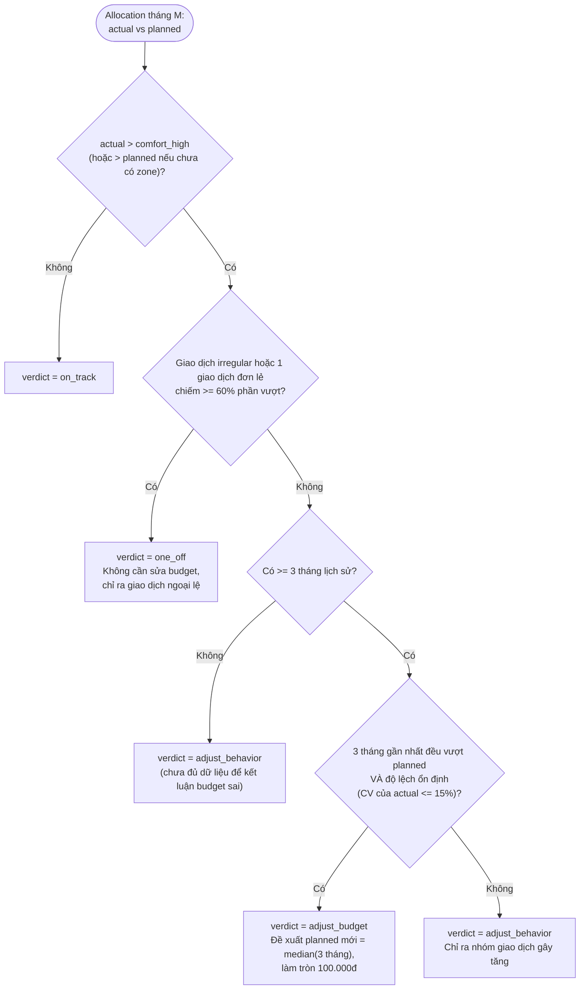
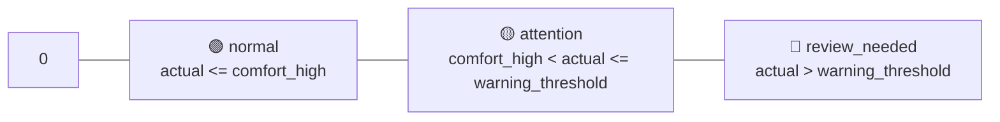

# Budget Adjustment & Flexible Zones

## 1. Budget sai hay hành vi sai? (Phase 8)

Khi `actual > planned` cho một allocation, **không mặc định sửa budget**. Logic phân loại hoàn toàn deterministic (`services/advisor_rules.py`); AI chỉ viết lời giải thích dựa trên `evidence`.

Ngưỡng (`60%`, `15%`, `3 tháng`) là hằng số cấu hình trong `app_setting`, có unit test cho từng nhánh.

### Test case chuẩn (lấy từ brainstorm)

| Case | Dữ liệu | Verdict mong đợi |
|---|---|---|
| Ăn uống | planned 4.000.000; actual 3 tháng: 4.400.000 / 4.600.000 / 4.500.000 | `adjust_budget`, đề xuất 4.500.000 |
| Mua sắm | planned 2.000.000; actual 8.000.000, trong đó 1 giao dịch laptop 6.500.000 (`irregular`) | `one_off`, chỉ ra giao dịch laptop |
| Giải trí | planned 1.000.000; actual 1.400.000, lịch sử 800k / 1.6tr / 1.4tr | `adjust_behavior` |
| Đi lại | planned 1.000.000; actual 700.000 | `on_track` |

**Cách hiểu khi triển khai (Phase 8):**
- "Giao dịch irregular … chiếm ≥ 60% phần vượt": **tổng** các giao dịch `spending_type = irregular` của dòng ≥ 60% phần vượt, **hoặc** giao dịch lớn nhất (bất kể loại) ≥ 60% phần vượt. Phần vượt = `actual − comfort_high` (hoặc `− planned` khi chưa có zone).
- "Lịch sử" = `min_history_months` tháng gần nhất **tính cả tháng đang xét**; tháng có dữ liệu = có ≥ 1 giao dịch chi trong phạm vi dòng (`budget_service.allocation_scope`). "Đều vượt planned" so với `planned` của tháng đang xét.
- CV = độ lệch chuẩn **tổng thể** (chia n) / trung bình; so ngưỡng chính xác bằng `CV² ≤ ngưỡng²` trên số hữu tỉ. Median n chẵn = trung bình 2 giá trị giữa; làm tròn đề xuất half-up tới `budget_rounding_step`.
- Không tạo advice cho dòng nhóm `savings`. Ngưỡng lưu ở `app_settings.budget_advisor`, sửa qua `PATCH /budget/advice/settings`.

## 2. Flexible Budget Zones (Phase 9)

Thay vì một con số cứng, mỗi allocation có 3 vùng:

| Mode | Cách tính |
|---|---|
| `manual` | User tự nhập `comfort_low`, `comfort_high`, `warning_threshold` |
| `auto` (mặc định khi có >= 3 tháng dữ liệu) | `comfort_high = max(planned, mean + 0.5*std)`, `warning_threshold = max(planned*1.1, mean + 1*std)`, `comfort_low = planned*0.875` — tính trên chi tiêu **không tính giao dịch irregular** của category đó trong 3–6 tháng gần nhất |
| `auto` khi thiếu dữ liệu | `comfort_low = 0.875*planned`, `comfort_high = 1.125*planned`, `warning_threshold = 1.25*planned` |

Zone còn có **pro-rata theo ngày** trong tháng đang chạy: so `actual` với `planned * (ngày đã qua / số ngày trong tháng)` để cảnh báo sớm ("đã dùng 80% budget ăn uống khi mới qua 50% tháng").

**Làm tròn:** ngưỡng zone tính ra số lẻ được làm tròn tới **đồng gần nhất** (`round_vnd(x, step=1)`, round-half-up — ví dụ `4.081.649,5` → `4.081.650`). Chỉ đề xuất `planned` mới của advisor mới làm tròn 100.000đ.
