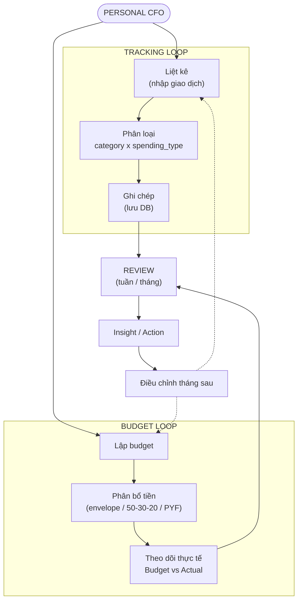
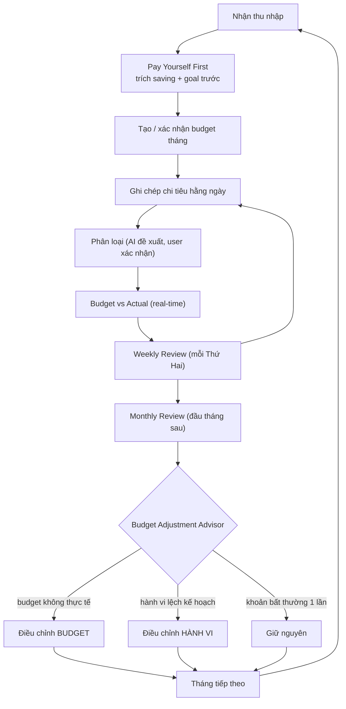

# Core Business Loop

Sản phẩm xoay quanh **2 vòng lặp** gặp nhau ở **Review**.

## Hai vòng lặp

## Vòng đời một tháng

## Feature nào phục vụ bước nào

| Bước | Feature | Phase |
|---|---|---|
| Liệt kê | Nhập thủ công, NL entry, OCR hoá đơn, import CSV, recurring | 1, 2, 13, 14, 12 |
| Phân loại | Category × spending_type, AI classifier học preference | 1, 2, 3 |
| Lập budget / Phân bổ | Budget engine 3 chiến lược, PYF + Goals | 4, 11 |
| Theo dõi thực tế | Budget vs Actual, Flexible zones, Calendar/forecast | 5, 9, 12 |
| Review | Weekly / Monthly review, reflection | 6, 7 |
| Insight / Action | Budget Adjustment Advisor, Financial Coach, semantic search, RAG, What-if | 8, 10, 15, 16, 17 |
