# Data Model (ERD)

Đây là mô hình dữ liệu **đích** tới Phase 17. Mỗi phase chỉ tạo bảng/cột của mình qua Alembic migration — không tạo trước.
Nếu thiết kế thực tế thay đổi khi triển khai, **cập nhật file này** trong cùng commit.

Quy ước chung:
- Sơ đồ và tài liệu dùng tên entity số ít (`transaction`, `category`); **tên bảng thực tế là số nhiều snake_case** (`transactions`, `categories`, `budget_allocations`...) — tránh trùng từ khoá SQL `TRANSACTION`.
- Khoá chính `id` kiểu `UUID` (sinh phía server).
- Mọi bảng nghiệp vụ có `created_at`, `updated_at` (`timestamptz`) — lược bỏ trong sơ đồ cho gọn.
- Bảng nghiệp vụ chính có `user_id UUID NULL` để mở rộng multi-user sau này ([ADR-004](./decisions/ADR-004-single-user-first.md)).
- Tiền: `BIGINT` đơn vị đồng ([ADR-007](./decisions/ADR-007-money-as-integer-vnd.md)).
- Enum lưu dạng `TEXT` + `CHECK` constraint (dễ migrate hơn Postgres native enum).

## Sơ đồ tổng thể

```mermaid
erDiagram
    CATEGORY ||--o{ TRANSACTION : "classifies"
    CATEGORY ||--o{ CLASSIFICATION_PREFERENCE : "preferred"
    CATEGORY ||--o{ BUDGET_ALLOCATION : "budgeted"
    CATEGORY ||--o{ RECURRING_TRANSACTION : "classifies"
    BUDGET ||--|{ BUDGET_ALLOCATION : "contains"
    BUDGET_ALLOCATION ||--o{ BUDGET_ADVICE : "advised"
    TRANSACTION ||--o{ CLASSIFICATION_FEEDBACK : "corrected"
    TRANSACTION ||--o| TRANSACTION_EMBEDDING : "embedded"
    TRANSACTION ||--o{ GOAL_CONTRIBUTION : "funds"
    GOAL ||--o{ GOAL_CONTRIBUTION : "receives"
    RECURRING_TRANSACTION ||--o{ TRANSACTION : "generates"
    RECEIPT |o--o| TRANSACTION : "becomes"
    IMPORT_BATCH ||--o{ TRANSACTION : "imports"
    WEEKLY_REVIEW ||--o{ REFLECTION_ANSWER : "asks"
    MONTHLY_REVIEW ||--o{ REFLECTION_ANSWER : "asks"
    CHAT_SESSION ||--o{ CHAT_MESSAGE : "has"
    KNOWLEDGE_DOCUMENT ||--|{ KNOWLEDGE_CHUNK : "split into"

    CATEGORY {
        uuid id PK
        text name "Tên hiển thị tiếng Việt"
        text slug UK
        text kind "income | expense"
        text default_spending_type "nullable"
        text icon
        bool is_system
        bool is_archived "ẩn thay vì xoá"
    }
    TRANSACTION {
        uuid id PK
        uuid user_id "nullable"
        text direction "income | expense"
        bigint amount "> 0, đồng"
        date occurred_on
        text note
        uuid category_id FK
        text spending_type "essential | non_essential | irregular | null"
        text source "manual | nl | receipt | import | recurring"
        text raw_input "câu gốc user nhập, nullable"
        jsonb ai_suggestion "đề xuất ban đầu của AI, nullable"
        uuid recurring_id FK "P12, nullable"
        uuid receipt_id FK "P13, nullable"
        uuid import_batch_id FK "P14, nullable"
        text dedup_hash "P14, nullable, unique"
    }
    APP_SETTING {
        text key PK
        jsonb value
    }
    CLASSIFICATION_PREFERENCE {
        uuid id PK
        text pattern "từ khoá đã chuẩn hoá"
        text example_text
        uuid category_id FK
        text spending_type
        int hit_count
        timestamptz last_used_at
    }
    CLASSIFICATION_FEEDBACK {
        uuid id PK
        uuid transaction_id FK
        uuid ai_category_id
        text ai_spending_type
        uuid final_category_id
        text final_spending_type
    }
    BUDGET {
        uuid id PK
        date period_month UK "ngày 1 của tháng"
        text strategy "envelope | fifty_thirty_twenty | pyf"
        bigint expected_income
        bigint savings_target
        text status "draft | active | closed"
    }
    BUDGET_ALLOCATION {
        uuid id PK
        uuid budget_id FK
        text group "essential | wants | savings | irregular"
        uuid category_id FK "nullable"
        text jar_name "nullable, cho envelope"
        bigint planned_amount
        bigint comfort_low "P9, nullable"
        bigint comfort_high "P9, nullable"
        bigint warning_threshold "P9, nullable"
        text zone_mode "P9: manual | auto"
    }
    BUDGET_ADVICE {
        uuid id PK
        uuid budget_allocation_id FK
        date month
        text verdict "adjust_budget | adjust_behavior | one_off | on_track"
        jsonb evidence
        text explanation
        text status "open | accepted | dismissed"
    }
    WEEKLY_REVIEW {
        uuid id PK
        date week_start UK "Thứ Hai"
        jsonb metrics "số liệu deterministic"
        jsonb narrative "observation, explanation, notice, action"
        text model
        text status "generated | completed"
    }
    MONTHLY_REVIEW {
        uuid id PK
        date month UK
        jsonb metrics
        jsonb narrative
        text model
        text status
    }
    REFLECTION_ANSWER {
        uuid id PK
        text review_kind "weekly | monthly"
        uuid review_id
        text question
        text answer
        uuid_array flagged_transaction_ids
    }
    CHAT_SESSION {
        uuid id PK
        text title
    }
    CHAT_MESSAGE {
        uuid id PK
        uuid session_id FK
        text role "user | assistant | tool"
        text content
        jsonb tool_calls
    }
    GOAL {
        uuid id PK
        text name
        bigint target_amount
        date deadline
        int priority
        text status "active | achieved | paused"
    }
    GOAL_CONTRIBUTION {
        uuid id PK
        uuid goal_id FK
        uuid income_transaction_id FK "nullable"
        bigint amount
        date contributed_on
    }
    RECURRING_TRANSACTION {
        uuid id PK
        text name
        text direction
        bigint amount
        uuid category_id FK
        text spending_type
        text frequency "weekly | monthly | yearly"
        int day_of_month
        date next_due_on
        bool auto_detected
        bool active
    }
    RECEIPT {
        uuid id PK
        text file_path
        text mime_type
        jsonb extracted
        text status "uploaded | extracted | confirmed | failed"
        uuid transaction_id FK "nullable"
    }
    IMPORT_BATCH {
        uuid id PK
        text filename
        text file_hash UK
        jsonb column_mapping
        int row_count
        text status "previewed | committed | failed"
    }
    TRANSACTION_EMBEDDING {
        uuid transaction_id PK
        vector embedding "vector(1536)"
        text content
        text model
    }
    KNOWLEDGE_DOCUMENT {
        uuid id PK
        text title
        text source "đường dẫn file gốc"
        text content_hash "để re-ingest idempotent"
    }
    KNOWLEDGE_CHUNK {
        uuid id PK
        uuid document_id FK
        int chunk_index
        text heading "nullable"
        text content
        vector embedding "vector(1536)"
        text model
        jsonb metadata "heading_path, tags, language"
    }
    IMPORT_MAPPING_PROFILE {
        uuid id PK
        text bank_name
        text headers_hash
        jsonb column_mapping
        text date_format
        text decimal_style
        timestamptz last_used_at
    }
    SCENARIO {
        uuid id PK
        text name
        jsonb params
        jsonb result
    }
```

## Bảng theo phase

Tên trong bảng dưới là **tên bảng thực tế** (số nhiều snake_case).

| Phase | Bảng / cột mới |
|---|---|
| 1 | `categories`, `transactions` (cột lõi + `source`, `raw_input`, `ai_suggestion` nullable), `app_settings` |
| 2 | — (dùng `transactions.raw_input`, `transactions.ai_suggestion` đã tạo ở P1). Giao dịch nhập bằng câu: `source='nl'`, `raw_input` = câu gốc, `ai_suggestion` = draft AI **trước khi user sửa** (`TransactionDraft` + `model`) |
| 3 | `classification_preferences`, `classification_feedback` |
| 4 | `budgets`, `budget_allocations` (cột lõi) |
| 5 | — (chỉ query/aggregate) |
| 6 | `weekly_reviews`, `reflection_answers` |
| 7 | `monthly_reviews` |
| 8 | `budget_advice` |
| 9 | `budget_allocations.comfort_low/comfort_high/warning_threshold/zone_mode` |
| 10 | `chat_sessions`, `chat_messages` |
| 11 | `goals`, `goal_contributions` |
| 12 | `recurring_transactions`, `transactions.recurring_id` |
| 13 | `receipts`, `transactions.receipt_id` |
| 14 | `import_batches`, `import_mapping_profiles`, `transactions.import_batch_id`, `transactions.dedup_hash` |
| 15 | `CREATE EXTENSION vector`, `transaction_embeddings` |
| 16 | `knowledge_documents`, `knowledge_chunks` |
| 17 | `scenarios` (tuỳ chọn — chỉ khi cần lưu kịch bản) |

## Ràng buộc quan trọng

- `transaction.amount > 0`; dấu thể hiện qua `direction`.
- `transaction.spending_type IS NULL` khi `direction = 'income'`; bắt buộc khi `direction = 'expense'`.
- `budget.period_month`, `budget_advice.month`, `monthly_review.month` luôn là ngày 1 (CHECK `extract(day from ...) = 1`).
- `weekly_review.week_start` luôn là Thứ Hai (CHECK `extract(isodow from week_start) = 1`).
- `budget_allocation`: phải có `category_id` **hoặc** `jar_name` (strategy envelope có thể dùng jar gom nhiều category — mapping jar → categories lưu ở `app_setting` hoặc bảng `jar_category` nếu cần, quyết định ở Phase 4).
- Index: `transaction(occurred_on)`, `transaction(category_id, occurred_on)`, HNSW index trên các cột `vector`.

## Ghi chú triển khai thực tế

**Phase 1** (migration `20261008_ac3898ef679d_core_transactions`):
- Tên constraint theo naming convention trong `app/core/db.py` (`pk_<table>`, `uq_<table>_<col>`, `ck_<table>_<name>`, `fk_<table>_<col>_<ref>`).
- `categories`: `slug` UNIQUE (ASCII snake_case, sinh từ `name` bỏ dấu, trùng thì thêm `_2`, `_3`…); CHECK `kind IN (income, expense)`, `default_spending_type` hợp lệ, `kind = 'expense' OR default_spending_type IS NULL`. Ở tầng API, category expense **bắt buộc** có `default_spending_type`. Không xoá — chỉ `is_archived`; không cho tạo/chuyển giao dịch sang category đã ẩn (giao dịch cũ giữ nguyên).
- `transactions`: CHECK `amount > 0`, `direction`, `spending_type`, `source`, và cặp `direction`/`spending_type`; FK `category_id` `ON DELETE RESTRICT`. Khớp `category.kind = direction` kiểm tra ở `transaction_service`. API giới hạn `amount ≤ 10^15`.
- `app_settings`: có `created_at`/`updated_at`; seed `week_start = "monday"`, `currency = "VND"`.
- PK UUID: `server_default gen_random_uuid()` (PG ≥ 13) + `uuid4` phía Python.
