# Data Model (ERD)

Đây là mô hình dữ liệu **đích** tới Phase 17. Mỗi phase chỉ tạo bảng/cột của mình qua Alembic migration — không tạo trước.
Nếu thiết kế thực tế thay đổi khi triển khai, **cập nhật file này** trong cùng commit.

Quy ước chung:
- Sơ đồ và tài liệu dùng tên entity số ít (`transaction`, `category`); **tên bảng thực tế là số nhiều snake_case** (`transactions`, `categories`, `budget_allocations`...) — tránh trùng từ khoá SQL `TRANSACTION`.
- Khoá chính `id` kiểu `UUID` (sinh phía server).
- Mọi bảng nghiệp vụ có `created_at`, `updated_at` (`timestamptz`) — lược bỏ trong sơ đồ cho gọn.
- Bảng nghiệp vụ chính có `user_id UUID NULL` để mở rộng multi-user sau này ([ADR-004](./decisions/ADR-004-single-user-first.md)).
- Tiền: `BIGINT` đơn vị đồng ([ADR-007](./decisions/ADR-007-money-as-integer-vnd.md)).
- Enum lưu dạng `TEXT` + `CHECK` constraint (dễ migrate hơn Postgres native enum).

## Sơ đồ tổng thể

```mermaid
erDiagram
    CATEGORY ||--o{ TRANSACTION : "classifies"
    CATEGORY ||--o{ CLASSIFICATION_PREFERENCE : "preferred"
    CATEGORY ||--o{ BUDGET_ALLOCATION : "budgeted"
    CATEGORY ||--o{ RECURRING_TRANSACTION : "classifies"
    BUDGET ||--|{ BUDGET_ALLOCATION : "contains"
    BUDGET_ALLOCATION ||--o{ BUDGET_ADVICE : "advised"
    TRANSACTION ||--o{ CLASSIFICATION_FEEDBACK : "corrected"
    TRANSACTION ||--o| TRANSACTION_EMBEDDING : "embedded"
    TRANSACTION ||--o{ GOAL_CONTRIBUTION : "funds"
    GOAL ||--o{ GOAL_CONTRIBUTION : "receives"
    RECURRING_TRANSACTION ||--o{ TRANSACTION : "generates"
    RECEIPT |o--o| TRANSACTION : "becomes"
    IMPORT_BATCH ||--o{ TRANSACTION : "imports"
    WEEKLY_REVIEW ||--o{ REFLECTION_ANSWER : "asks"
    MONTHLY_REVIEW ||--o{ REFLECTION_ANSWER : "asks"
    CHAT_SESSION ||--o{ CHAT_MESSAGE : "has"
    KNOWLEDGE_DOCUMENT ||--|{ KNOWLEDGE_CHUNK : "split into"

    CATEGORY {
        uuid id PK
        text name "Tên hiển thị tiếng Việt"
        text slug UK
        text kind "income | expense"
        text default_spending_type "nullable"
        text icon
        bool is_system
        bool is_archived "ẩn thay vì xoá"
    }
    TRANSACTION {
        uuid id PK
        uuid user_id "nullable"
        text direction "income | expense"
        bigint amount "> 0, đồng"
        date occurred_on
        text note
        uuid category_id FK
        text spending_type "essential | non_essential | irregular | null"
        text source "manual | nl | receipt | import | recurring"
        text raw_input "câu gốc user nhập, nullable"
        jsonb ai_suggestion "đề xuất ban đầu của AI, nullable"
        uuid recurring_id FK "P12, nullable"
        uuid receipt_id FK "P13, nullable"
        uuid import_batch_id FK "P14, nullable"
        text dedup_hash "P14, nullable, unique"
    }
    APP_SETTING {
        text key PK
        jsonb value
    }
    CLASSIFICATION_PREFERENCE {
        uuid id PK
        uuid user_id "nullable"
        text pattern "từ khoá đã chuẩn hoá, UK (user_id, pattern)"
        text example_text
        uuid category_id FK
        text spending_type "null nếu category income"
        int hit_count
        timestamptz last_used_at
    }
    CLASSIFICATION_FEEDBACK {
        uuid id PK
        uuid transaction_id FK
        uuid ai_category_id FK "nullable"
        text ai_spending_type
        uuid final_category_id FK
        text final_spending_type
    }
    BUDGET {
        uuid id PK
        date period_month UK "ngày 1 của tháng"
        text strategy "envelope | fifty_thirty_twenty | pyf"
        bigint expected_income
        bigint savings_target
        text status "draft | active | closed"
    }
    BUDGET_ALLOCATION {
        uuid id PK
        uuid budget_id FK
        text group "essential | wants | savings | irregular"
        uuid category_id FK "nullable"
        text jar_name "nullable, hũ envelope hoặc tên nhóm"
        bigint planned_amount
        int position "thứ tự hiển thị"
        bigint comfort_low "P9, nullable (auto chưa tính)"
        bigint comfort_high "P9, nullable"
        bigint warning_threshold "P9, nullable"
        text zone_mode "P9: manual | auto (mặc định auto)"
    }
    BUDGET_ADVICE {
        uuid id PK
        uuid budget_allocation_id FK
        date month
        text verdict "adjust_budget | adjust_behavior | one_off | on_track"
        jsonb evidence
        text explanation
        jsonb narrative "P8: 3 tầng + generated_by + fallback_reason"
        text model
        text status "open | accepted | dismissed"
        date applied_month "P8: tháng đã áp dụng planned mới"
        text dismiss_reason
    }
    WEEKLY_REVIEW {
        uuid id PK
        date week_start UK "Thứ Hai"
        jsonb metrics "số liệu deterministic"
        jsonb narrative "observation, explanation, notice, action"
        text model
        text status "generated | completed"
    }
    MONTHLY_REVIEW {
        uuid id PK
        date month UK "ngày 1"
        jsonb metrics "số liệu tháng + budget + phản tư tuần"
        jsonb narrative
        text model
        text status "generated | completed"
    }
    REFLECTION_ANSWER {
        uuid id PK
        text review_kind "weekly | monthly"
        uuid review_id
        text question
        text answer
        uuid_array flagged_transaction_ids
    }
    CHAT_SESSION {
        uuid id PK
        text title
        timestamptz updated_at
    }
    CHAT_MESSAGE {
        uuid id PK
        uuid session_id FK
        text role "user | assistant | tool"
        text content
        jsonb tool_calls
        jsonb evidence
        jsonb metadata
    }
    GOAL {
        uuid id PK
        uuid user_id "nullable"
        text name
        bigint target_amount "> 0"
        date deadline
        int priority "> 0, 1 = cao nhất"
        text status "active | achieved | paused"
    }
    GOAL_CONTRIBUTION {
        uuid id PK
        uuid goal_id FK
        uuid income_transaction_id FK "nullable (null = góp thủ công)"
        bigint amount "> 0"
        date contributed_on
    }
    RECURRING_TRANSACTION {
        uuid id PK
        uuid user_id "nullable"
        text name
        text direction "income | expense"
        bigint amount "> 0"
        uuid category_id FK
        text spending_type "null nếu income"
        text frequency "weekly | monthly | yearly"
        int day_of_month "monthly / yearly: 1-31"
        int day_of_week "weekly: 1-7 (ISO)"
        date next_due_on "kỳ kế tiếp chưa ghi"
        bool auto_detected
        bool active
    }
    RECEIPT {
        uuid id PK
        text file_path "tương đối trong UPLOAD_DIR"
        text mime_type
        text original_filename
        int file_size_bytes
        text sha256 "cảnh báo upload trùng"
        jsonb extracted "output model vision + suggestion"
        jsonb draft "P13: TransactionDraft lúc trích xuất"
        text model
        text status "uploaded | extracted | confirmed | failed"
        text error_code
        uuid transaction_id FK "nullable"
    }
    IMPORT_BATCH {
        uuid id PK
        text filename
        text file_hash UK
        text bank_name "nullable"
        jsonb column_mapping
        jsonb source_rows "P14: bảng thô"
        jsonb rows "P14: dòng preview"
        int row_count
        int committed_count
        text status "previewed | committed | failed"
    }
    TRANSACTION_EMBEDDING {
        uuid transaction_id PK
        vector embedding "vector(1536)"
        text content
        text model
    }
    KNOWLEDGE_DOCUMENT {
        uuid id PK
        text title
        text source "đường dẫn file gốc"
        text content_hash "để re-ingest idempotent"
    }
    KNOWLEDGE_CHUNK {
        uuid id PK
        uuid document_id FK
        int chunk_index
        text heading "nullable"
        text content
        vector embedding "vector(1536)"
        text model
        jsonb metadata "heading_path, tags, language"
    }
    IMPORT_MAPPING_PROFILE {
        uuid id PK
        text bank_name "UK (bank_name, headers_hash)"
        text headers_hash
        jsonb headers
        jsonb column_mapping
        text date_format
        text decimal_style
        timestamptz last_used_at
    }
    SCENARIO {
        uuid id PK
        text name
        jsonb params
        jsonb result
    }
```

## Bảng theo phase

Tên trong bảng dưới là **tên bảng thực tế** (số nhiều snake_case).

| Phase | Bảng / cột mới |
|---|---|
| 1 | `categories`, `transactions` (cột lõi + `source`, `raw_input`, `ai_suggestion` nullable), `app_settings` |
| 2 | — (dùng `transactions.raw_input`, `transactions.ai_suggestion` đã tạo ở P1). Giao dịch nhập bằng câu: `source='nl'`, `raw_input` = câu gốc, `ai_suggestion` = draft AI **trước khi user sửa** (`TransactionDraft` + `model`) |
| 3 | `classification_preferences`, `classification_feedback` (tên bảng giữ dạng không đếm được `feedback`) |
| 4 | `budgets`, `budget_allocations` (cột lõi + `position`), `app_settings.budget_jar_category_map` |
| 5 | — (chỉ query/aggregate) |
| 6 | `weekly_reviews`, `reflection_answers` |
| 7 | `monthly_reviews` |
| 8 | `budget_advice` (tên bảng giữ dạng không đếm được `advice`), `app_settings.budget_advisor` |
| 9 | `budget_allocations.comfort_low/comfort_high/warning_threshold/zone_mode` (+ CHECK `zone_mode`) |
| 10 | `chat_sessions`, `chat_messages` (+ cột `evidence` so với plan) |
| 11 | `goals`, `goal_contributions` |
| 12 | `recurring_transactions`, `transactions.recurring_id`, `app_settings.forecast.*`, `app_settings.recurring.*` |
| 13 | `receipts` (+ `draft`, `model` so với plan), `transactions.receipt_id` |
| 14 | `import_batches` (+ `source_rows`, `rows`, `file_info`… so với plan), `import_mapping_profiles` (+ `headers`), `transactions.import_batch_id`, `transactions.dedup_hash` (unique partial index) |
| 15 | `CREATE EXTENSION vector`, `transaction_embeddings` |
| 16 | `knowledge_documents`, `knowledge_chunks` |
| 17 | `scenarios` (tuỳ chọn — chỉ khi cần lưu kịch bản) |

## Ràng buộc quan trọng

- `transaction.amount > 0`; dấu thể hiện qua `direction`.
- `transaction.spending_type IS NULL` khi `direction = 'income'`; bắt buộc khi `direction = 'expense'`.
- `budget.period_month`, `budget_advice.month`, `monthly_review.month` luôn là ngày 1 (CHECK `extract(day from ...) = 1`).
- `weekly_review.week_start` luôn là Thứ Hai (CHECK `extract(isodow from week_start) = 1`).
- `budget_allocation`: phải có `category_id` **hoặc** `jar_name` (đúng một trong hai). Mapping hũ → danh mục lưu ở `app_settings.budget_jar_category_map` (quyết định ở Phase 4).
- Index: `transaction(occurred_on)`, `transaction(category_id, occurred_on)`, HNSW index trên các cột `vector`.

## Ghi chú triển khai thực tế

**Phase 1** (migration `20261008_ac3898ef679d_core_transactions`):
- Tên constraint theo naming convention trong `app/core/db.py` (`pk_<table>`, `uq_<table>_<col>`, `ck_<table>_<name>`, `fk_<table>_<col>_<ref>`).
- `categories`: `slug` UNIQUE (ASCII snake_case, sinh từ `name` bỏ dấu, trùng thì thêm `_2`, `_3`…); CHECK `kind IN (income, expense)`, `default_spending_type` hợp lệ, `kind = 'expense' OR default_spending_type IS NULL`. Ở tầng API, category expense **bắt buộc** có `default_spending_type`. Không xoá — chỉ `is_archived`; không cho tạo/chuyển giao dịch sang category đã ẩn (giao dịch cũ giữ nguyên).
- `transactions`: CHECK `amount > 0`, `direction`, `spending_type`, `source`, và cặp `direction`/`spending_type`; FK `category_id` `ON DELETE RESTRICT`. Khớp `category.kind = direction` kiểm tra ở `transaction_service`. API giới hạn `amount ≤ 10^15`.
- `app_settings`: có `created_at`/`updated_at`; seed `week_start = "monday"`, `currency = "VND"`.
- PK UUID: `server_default gen_random_uuid()` (PG ≥ 13) + `uuid4` phía Python.

**Phase 3** (migration `20261019_06a6605af7ab_classification_learning`):
- `classification_preferences`: **mỗi pattern 1 preference** — `UNIQUE (user_id, pattern) NULLS NOT DISTINCT` (PG ≥ 15) thay cho unique `(user_id, pattern, category_id, spending_type)` gợi ý trong plan, để không có 2 cách phân loại mâu thuẫn cho cùng từ khoá; user đổi ý thì cập nhật (và `hit_count` đếm lại). CHECK `spending_type` hợp lệ, `hit_count >= 0`, `length(pattern) >= 2`. FK `category_id` `ON DELETE CASCADE`. Index `pattern`, `last_used_at DESC`. Ràng buộc `spending_type IS NULL` ⇔ category income kiểm tra ở `classification_preference_service`.
- `pattern` lưu dạng đã chuẩn hoá (`services/classification_text.normalize_pattern`: lowercase, bỏ dấu, bỏ số tiền, bỏ từ chung) — ví dụ `giay`, `sua laptop`, `tien upwork`. `hit_count` = số lần user **xác nhận** cách phân loại này (correction tạo/cập nhật = 1 lần; lưu draft dùng preference mà không sửa = +1); preference tường minh mới tạo có `hit_count = 0`.
- `classification_feedback`: FK `transaction_id` `ON DELETE CASCADE`, `ai_category_id` `ON DELETE SET NULL`, `final_category_id` `ON DELETE RESTRICT`; CHECK hai cột spending_type. Index `transaction_id`. Chỉ ghi khi user sửa category/spending_type so với `transactions.ai_suggestion` lúc `POST /transactions` (sửa sau bằng PATCH chưa ghi).

**Phase 4** (migration `20261019_2af9a678b445_budget_engine`):
- `budgets`: `UNIQUE (period_month)` — **mỗi tháng 1 budget bất kể status**; CHECK `extract(day from period_month) = 1`, `strategy`, `status IN (draft, active, closed)`, `expected_income >= 0`, `savings_target >= 0`. `savings_target` = tổng `planned_amount` nhóm `savings`, do `budget_service` đồng bộ khi lưu (không nhận từ request tạo/sửa).
- `budget_allocations`: CHECK `"group" IN (essential, wants, savings, irregular)`, `planned_amount >= 0`, `(category_id IS NOT NULL) <> (jar_name IS NOT NULL)`; FK `budget_id` `ON DELETE CASCADE`, `category_id` `ON DELETE RESTRICT`; index `budget_id`, `category_id`. Thêm cột **`position INT`** (thứ tự hiển thị). Không có `user_id` (thuộc budget).
- `app_settings.budget_jar_category_map` (seed trong migration): `{"Essential": [housing, food, transport, utilities, health, education], "Fun": [entertainment, gifts], "Shopping": [shopping, electronics], "Saving": [], "Unexpected": [other]}` (slug danh mục chi).
- **Cách một dòng phân bổ khớp giao dịch chi** (`budget_service.allocation_scope`, Phase 5 dùng để tính actual):

  | Dòng | Khớp giao dịch `direction = expense` có |
  |---|---|
  | `category_id` khác null (mọi strategy) | `category_id` đó |
  | `jar_name` của budget `envelope` (hũ) | `category_id` thuộc danh sách slug của hũ trong `budget_jar_category_map` |
  | `jar_name` của budget `fifty_thirty_twenty` / `pyf` (dòng nhóm, `jar_name = group`) | `spending_type`: `essential` → nhóm essential, `non_essential` → wants, `irregular` → irregular; nhóm `savings` không khớp chi tiêu (actual = 0; Phase 11 vẫn giữ — khoản góp goal không tính vào dòng savings) |

  Service chặn các dòng chồng lấn trong 1 budget (cùng danh mục ở 2 dòng / vừa dòng nhóm vừa dòng danh mục → 422 `overlapping_allocations`) nên cộng actual theo dòng không bị đếm trùng.

**Phase 5** (không có migration): actual tính trực tiếp bằng SQL aggregate (`transaction_repository.expense_totals_by_category_and_spending_type` — 1 truy vấn gộp theo `(category_id, spending_type)` cho cả tháng, `analytics_service` cộng theo phạm vi từng dòng), dùng index `transactions(occurred_on)` / `(category_id, occurred_on)` có sẵn. Mọi dòng thuộc nhóm `savings` (kể cả dòng có `category_id`) có actual = 0 (Phase 11 không đổi, xem ghi chú Phase 11). Chưa cần materialized view / cache.

**Phase 6** (migration `20261020_63c5cd20a0e3_weekly_review`):
- `weekly_reviews`: `UNIQUE (week_start)`, CHECK `extract(isodow from week_start) = 1`, `status IN (generated, completed)`. `metrics` JSONB = `ReviewMetrics` (thu/chi/net, kỳ trước, `expense_change(_pct)`, `by_spending_type`, `by_category` có `change_pct`, tiến độ tuần `days_elapsed`/`complete`/`as_of`, `highlights`: top 3 danh mục, `top_increase`/`top_decrease`, cụm lặp, top 3 khoản chi). `narrative` JSONB = `ReviewNarrative` (`observation`, `explanation`, `notice[1..3]`, `action`, `reflection_question`, `tone`, `fallback_used`, `fallback_reason`). `model` = tên model AI hoặc `fallback_template`. Regenerate ghi đè `metrics`/`narrative`/`model` và đặt lại `status = generated` (cùng row).
- `reflection_answers`: CHECK `review_kind IN (weekly, monthly)`; **không có FK** `review_id` (trỏ `weekly_reviews` hoặc `monthly_reviews` tuỳ `review_kind`); index `(review_kind, review_id)`. `question` = `narrative.reflection_question` lúc trả lời; `flagged_transaction_ids UUID[]` default `'{}'` — `review_service` chỉ nhận khoản **chi** thuộc tuần của review (khác tuần → 422 `flagged_transaction_out_of_week`, thu nhập → 422 `flagged_transaction_not_expense`). Lưu reflection → review `completed`. Reflection giữ nguyên khi regenerate.

**Phase 7** (migration `20261021_79e40a3c073b_monthly_review`):
- `monthly_reviews`: `UNIQUE (month)`, CHECK `extract(day from month) = 1`, `status IN (generated, completed)`; cùng cột với `weekly_reviews` (`metrics`, `narrative`, `model`, `status`, `user_id` nullable). `metrics` JSONB = `MonthlyReviewMetrics` = `ReviewMetrics` (chung với tuần) + `saved`, `savings_rate_pct` (1 chữ số, `null` khi thu = 0), `previous_saved`, `previous_savings_rate_pct`, `saved_change`, `income_change(_pct)`, `spending_type_pct` (tỉ trọng 1 chữ số), `regular_expense` (= chi − bất thường), `previous_regular_expense`, `regular_expense_change_pct`, `irregular_change`, `increase_driver` (`irregular` khi chi bất thường tăng ≥ 50% mức tăng tổng; `null` khi chi không tăng / tháng trước không có chi), `irregular_items` (≤ 5), `budget` (`MonthlyBudgetSummary` — chỉ khi budget active/closed: dòng planned/actual/variance/status, tối đa 3 `over_lines`, `unbudgeted_actual`), `weekly_reflections` (phản tư của các review tuần có **Thứ Hai trong tháng**, câu trả lời cắt 300 ký tự, giao dịch đánh dấu đã xoá bị bỏ), `flagged_count` / `flagged_total` (giao dịch khác nhau). `narrative` cùng shape với tuần.
- `reflection_answers` dùng lại với `review_kind = 'monthly'`, `review_id = monthly_reviews.id`; giao dịch đánh dấu phải là khoản **chi** trong tháng (khác tháng → 422 `flagged_transaction_out_of_month`).

**Phase 8** (migration `20261021_461f51a98cbc_budget_advice`):
- `budget_advice`: CHECK `extract(day from month) = 1`, `verdict IN (adjust_budget, adjust_behavior, one_off, on_track)`, `status IN (open, accepted, dismissed)` (mặc định `open`); FK `budget_allocation_id` → `budget_allocations` `ON DELETE CASCADE` (xoá budget nháp / thay phân bổ bằng PATCH → advice của dòng cũ mất theo); **unique một phần** `uq_budget_advice_open_allocation_month (budget_allocation_id, month) WHERE status = 'open'`; index `month`, `budget_allocation_id`; `user_id` nullable. Cột thêm so với thiết kế: `narrative JSONB` (`observation`, `explanation`, `action`, `tone`, `generated_by = ai | template`, `fallback_reason`), `model` (tên model / `template` / `fallback_template`), `applied_month DATE` (accept), `dismiss_reason TEXT`. `explanation` = 3 tầng nối thành 1 đoạn.
- `evidence` JSONB = `BudgetAdviceEvidence` (do `services/advisor_rules` tính): `allocation_label`, `group`, `category_slug`, `month`, `as_of`, `month_complete`, `planned_amount`, `actual_amount`, `variance`, `comfort_high` (Phase 9), `comfort_high_used`, `threshold_amount`, `over_amount`, `transaction_count`, `largest_transaction`, `single_transaction_share(_pct)`, `irregular_total`, `irregular_share(_pct)`, `irregular_transaction`, `one_off_transaction`, `history_actuals[{month, actual, transaction_count, has_data, over_planned}]` (`min_history_months` tháng, tính cả tháng xét, cũ nhất trước), `history_months`, `min_history_months`, `all_over_planned`, `cv`/`cv_pct` (population std / mean), `history_median`, `proposed_planned_amount` (chỉ `adjust_budget`), `one_off_share_threshold_pct`, `stable_cv_threshold_pct`, `budget_rounding_step`, `rule` (`within_plan | one_off_irregular | one_off_single_transaction | insufficient_history | stable_overspend | unstable_overspend`).
- `app_settings.budget_advisor` (seed trong migration): `{"one_off_share_threshold": 0.6, "stable_cv_threshold": 0.15, "min_history_months": 3, "budget_rounding_step": 100000}`; key thiếu / giá trị sai kiểu → service dùng mặc định.
- Accept ghi vào `budget_allocations` của tháng đích qua `budget_service.set_allocation_planned` — sửa `planned_amount` **tại chỗ** (giữ id dòng), thiếu dòng thì thêm dòng cuối; tháng đích chưa có budget → tạo nháp copy từ tháng của advice (cùng commit).

**Phase 9** (migration `20261022_b151e98b6b47_flexible_budget_zones`):
- `budget_allocations` thêm `comfort_low BIGINT NULL`, `comfort_high BIGINT NULL`, `warning_threshold BIGINT NULL`, `zone_mode TEXT NOT NULL DEFAULT 'auto'` + CHECK `ck_budget_allocations_zone_mode` (`zone_mode IN ('manual', 'auto')`). Không có bảng `budget_zones`. Dòng cũ sau migration: `auto`, ngưỡng NULL.
- Ý nghĩa: `manual` → 3 ngưỡng user nhập, `zone_service` bắt buộc đủ và `comfort_low <= comfort_high <= warning_threshold` (CHECK thứ tự **không** đặt ở DB). `auto` → ngưỡng là **cache** do `zone_service` tính (NULL = chưa tính — UI hiện "Chưa tính vùng", advisor so với `planned`); chỉ ghi khi user bấm tính lại (`POST /budgets/{id}/zones/recalculate`) hoặc chuyển sang auto (`PATCH /budget-allocations/{id}/zone`). Dòng nhóm `savings` không có vùng (ngưỡng luôn NULL).
- Giữ ngưỡng khi dòng được ghi lại (`budget_service`): PATCH budget thay toàn bộ phân bổ → dòng cùng danh mục / hũ giữ `zone_mode` + ngưỡng manual, giữ cache auto nếu `planned_amount` không đổi (đổi → NULL); copy sang tháng mới → giữ manual, bỏ cache auto (lịch sử khác tháng); `set_allocation_planned` (accept advice) đổi planned của dòng auto → bỏ cache.
- `budget_advice.evidence` thêm `zone` (`ZoneEvidence`: `zone_mode`, `planned_amount`, `comfort_low`, `comfort_high`, `warning_threshold`, `actual_amount`, `zone`, `early_warning`) khi dòng đã có ngưỡng; `comfort_high` lấy từ cột đã lưu.

**Phase 10** (migration `20261022_cd108ee2d244_financial_coach`):
- `chat_sessions`: `id`, `user_id UUID NULL`, `title TEXT NOT NULL` (mặc định "Cuộc trò chuyện mới"; đổi theo câu hỏi đầu tiên, vd "Tao nên giảm khoản nào?" → "Nên giảm khoản nào"), `created_at`, `updated_at` (cập nhật mỗi khi có message mới — giờ phía Python, không phải `now()` của transaction). Index `ix_chat_sessions_updated_at (updated_at)` (btree quét ngược cho `ORDER BY updated_at DESC`).
- `chat_messages`: FK `session_id` → `chat_sessions` `ON DELETE CASCADE`; CHECK `ck_chat_messages_role` (`role IN ('user', 'assistant', 'tool')` — Phase 10 chỉ ghi `user` / `assistant`, tool trace nằm trong assistant message); `content TEXT NOT NULL`; `tool_calls JSONB` = `[{name, args, result_summary, result_count, evidence_refs, latency_ms, error}]`; **`evidence JSONB`** (thêm so với plan) = bảng "Dữ liệu đã dùng" `[{ref, tool, label, period, metric, amount}]`; `metadata JSONB` (thuộc tính ORM `meta` vì `metadata` là tên dành riêng của SQLAlchemy) = `{model, prompt_version, input_tokens, output_tokens, total_tokens, estimated_cost_vnd, llm_calls, tool_rounds, latency_ms, guard_status, guard_problems}` — không lưu prompt / API key. `created_at` đặt từ Python để thứ tự message đúng cả khi ghi trong cùng transaction. Index `ix_chat_messages_session_id_created_at (session_id, created_at)`.
- Không đổi bảng nghiệp vụ; Coach chỉ đọc qua `services/insight_service`.

**Phase 11** (migration `20261022_bdb3df82523e_goals_pyf`):
- `goals`: `user_id UUID NULL`, `name TEXT NOT NULL` (API 1–100 ký tự), `target_amount BIGINT` CHECK `ck_goals_target_amount_positive` (`> 0`), `deadline DATE NOT NULL`, `priority INT` CHECK `ck_goals_priority_positive` (`> 0`; API 1–100, 1 = cao nhất, cho phép trùng — hoà thì hạn sớm hơn, rồi ngày tạo), `status TEXT NOT NULL DEFAULT 'active'` CHECK `ck_goals_status` (`active | achieved | paused`), timestamps. Index `ix_goals_status_priority (status, priority)`, `ix_goals_deadline (deadline)`. **Không có cột `current_amount`** — `goal_service` luôn tính `SUM(goal_contributions.amount)`.
- `goal_contributions`: FK `goal_id` → `goals` `ON DELETE CASCADE`; FK `income_transaction_id` → `transactions` **`ON DELETE SET NULL`** (xoá thu nhập → giữ khoản góp, bỏ liên kết; plan chưa nói); `amount BIGINT` CHECK `ck_goal_contributions_amount_positive` (`> 0`); `contributed_on DATE NOT NULL` (= `occurred_on` của thu nhập với khoản góp PYF; khoản góp thủ công không ở tương lai). Index `ix_goal_contributions_goal_id_contributed_on`, `ix_goal_contributions_income_transaction_id`. `income_transaction_id` NULL = khoản góp thủ công (vd số tiền đã có sẵn).
- Ràng buộc ở service (không ở DB): `income_transaction_id` phải là giao dịch `direction = 'income'`; một thu nhập chỉ được xác nhận phân bổ **một lần** (đã có khoản góp → 409 `income_already_allocated`); khoản góp chỉ cho goal `active` và không vượt phần còn thiếu; tổng goal + `budget_savings_amount` ≤ thu nhập; thu nhập đã cấp tiền không đổi được thành khoản chi / giảm dưới tổng đã phân bổ. `status` tự chuyển `active → achieved` khi đủ tiền và `achieved → active` khi xoá khoản góp / tăng target làm thiếu tiền.
- `budget_savings_amount` (khoản tiết kiệm ngân sách chưa gắn goal) **không lưu** — chỉ để tính `available_spending`; `transactions` không thêm cột. Dòng nhóm `savings` của budget vẫn `not_tracked` (actual 0) như Phase 5.

**Phase 12** (migration `20261022_a46a3e1b041a_calendar_forecast`):
- `recurring_transactions`: `user_id UUID NULL`, `name TEXT NOT NULL` (API 1–100 ký tự), `direction`, `amount BIGINT`, `category_id` FK → `categories` `ON DELETE RESTRICT`, `spending_type`, `frequency`, `day_of_month INT NULL`, `day_of_week INT NULL`, `next_due_on DATE NOT NULL`, `auto_detected BOOL DEFAULT false`, `active BOOL DEFAULT true`, timestamps. CHECK `ck_recurring_transactions_amount_positive` (`> 0`), `_direction`, `_spending_type`, `_direction_spending_type` (income ⇔ `spending_type IS NULL`, như `transactions`), `_frequency` (`weekly | monthly | yearly`), **`_schedule`**: `weekly` ⇒ `day_of_week BETWEEN 1 AND 7` và `day_of_month IS NULL`; `monthly` / `yearly` ⇒ `day_of_month BETWEEN 1 AND 31` và `day_of_week IS NULL`. Index `ix_recurring_transactions_active_next_due_on (active, next_due_on)`, `ix_recurring_transactions_category_id`. Khác plan: thêm cột `day_of_week` vào sơ đồ (plan § 4.1 đã có); `yearly` dùng `day_of_month` làm ngày gốc + **tháng của `next_due_on`** (29/02 → 28/02 năm không nhuận rồi về lại 29/02) thay vì chỉ giữ ngày của `next_due_on`.
- Ý nghĩa `next_due_on` = kỳ kế tiếp **chưa ghi** thành giao dịch; có thể < hôm nay (quá hạn, chưa xác nhận). Ràng buộc ở `recurring_service`: danh mục cùng chiều, chưa ẩn; `next_due_on` phải là một kỳ hợp lệ của lịch (422 `next_due_on_mismatch`); bỏ trống → kỳ đầu tiên **sau** hôm nay. DELETE chỉ tắt (`active = false`), không xoá dòng.
- `transactions.recurring_id UUID NULL` FK → `recurring_transactions` **`ON DELETE SET NULL`** + index `ix_transactions_recurring_id`. Được đặt khi (a) "Tạo giao dịch" từ khoản định kỳ (`source = 'recurring'`) hoặc (b) user xác nhận đề xuất phát hiện → các giao dịch lịch sử của mẫu được gắn (giữ `source` cũ). API không cho sửa cột này.
- `app_settings` (seed trong migration): `forecast.low_balance_threshold = 1000000`, `forecast.goal_saving_day_of_month = 10`. Không seed: `forecast.starting_balance` (số nguyên đồng, có thể âm / 0; NULL = chưa nhập), `forecast.starting_balance_on` (ISO date — số dư tính tại đầu ngày này; mặc định hôm nay khi user nhập số dư), `recurring.suggestions` (`RecurringSuggestionList` của lần phát hiện gần nhất — đề xuất **không** có bảng riêng, id ổn định = UUID5 của khoá mẫu), `recurring.dismissed_suggestions` (danh sách khoá mẫu user đã bỏ qua, tối đa 200). Downgrade xoá cả 6 key.
- Forecast / lịch không có bảng / cache: `forecast_service` tính từ `recurring_transactions`, `transactions` (gộp theo ngày), `goals` + `goal_contributions`.

**Phase 13** (migration `20261022_f74480029b52_receipt_ocr`):
- `receipts`: `user_id UUID NULL`, `file_path TEXT NOT NULL` (**tương đối, posix** trong `UPLOAD_DIR`: `receipts/YYYY/MM/{id}.{jpg|png|webp|heic|heif}` — tên file = id receipt; `UPLOAD_DIR` tương đối tính từ thư mục `backend/`), `mime_type` (theo **magic bytes**, không theo content type khai báo), `original_filename` (đã bỏ thư mục, ≤ 255 ký tự), `file_size_bytes INT` CHECK `ck_receipts_file_size_positive` (`> 0`; API giới hạn 10MB = 10.485.760 byte), `sha256 TEXT NOT NULL`, `extracted JSONB` (`ReceiptVisionOutput` = `merchant`, `date`, `total`, `currency`, `items[{name, qty, amount}]`, `confidence`, `unreadable_reason`, `category_slug`, `spending_type`, `classification_reason` + khoá `suggestion` = `ClassificationSuggestion` sau khi áp sở thích phân loại; giữ cả khi `failed` vì chưa đủ tin cậy, NULL khi AI lỗi), **`draft JSONB`** (thêm so với plan — `TransactionDraft` dựng lúc trích xuất, chỉ khi `extracted`; thành `ai_suggestion` khi xác nhận), **`model TEXT`** (thêm so với plan), `status TEXT DEFAULT 'uploaded'` CHECK `ck_receipts_status` (`uploaded | extracted | confirmed | failed`), `error_code`, `error_message`, `transaction_id` FK → `transactions` **`ON DELETE SET NULL`** (xoá giao dịch → receipt vẫn `confirmed`, bỏ liên kết), timestamps (`created_at` đặt từ Python để thứ tự lịch sử đúng). Index `ix_receipts_status_created_at (status, created_at)`, `ix_receipts_sha256` (**không unique** — upload trùng chỉ cảnh báo `duplicate_of`).
- `transactions.receipt_id UUID NULL` FK → `receipts` **`ON DELETE SET NULL`** + index `ix_transactions_receipt_id`; chỉ đặt bởi `POST /receipts/{id}/confirm` (`source = 'receipt'`, `raw_input = "Hoá đơn {merchant} ({tên file})"`, `ai_suggestion = draft gốc + model + receipt_extraction`). API giao dịch không sửa được cột này. Hai FK vòng (`receipts.transaction_id` ↔ `transactions.receipt_id`): ORM đặt `use_alter` cho `receipts.transaction_id`, migration tạo bảng sau `transactions` nên tạo FK trực tiếp.
- Trạng thái: upload → `uploaded` (commit, file đã lưu) → trích xuất → `extracted` (có `total` > 0, VND, `confidence` ≥ 0.6, có danh mục chi) hoặc `failed` (`error_code`: mã AI `AI_*`, `unreadable`, `total_missing`, `invalid_total`, `unsupported_currency`, `low_confidence`, `image_unreadable`, `file_missing`, `category_missing`) → `confirmed` khi user xác nhận (kể cả từ `failed` qua form nhập tay). `retry` chỉ cho `uploaded` / `failed`, giữ id + file.

**Phase 14** (migration `20261022_3c9e5d1a7b20_csv_import`):
- `import_batches`: `user_id UUID NULL`, `filename TEXT NOT NULL` (đã bỏ thư mục, ≤ 255 ký tự), `file_hash TEXT NOT NULL` **UNIQUE** `uq_import_batches_file_hash` (sha256 nội dung file — upload lại file chưa commit dùng lại batch; đã commit → 409 `IMPORT_ALREADY_COMMITTED`), `file_type TEXT` (`csv | xlsx`), `file_size_bytes INT`, `bank_name TEXT NULL` (đã gọn khoảng trắng, ≤ 100), `column_mapping JSONB` (`{date, description, amount | debit / credit}` = **tên cột** trong file), `date_format` (`dd/mm/yyyy | mm/dd/yyyy | yyyy-mm-dd`), `decimal_style` (`dot_thousands | comma_thousands`), `mapping_source` (`guess | profile | user`), `file_info JSONB` (`file_type`, `size_bytes`, `encoding` `utf-8 | utf-8-sig | cp1258`, `separator`, `separator_label`, `sheet_name`, `header_row` (từ 1), `headers` (tên cột duy nhất), `warnings`, `headers_hash`, `profile_id`), **`source_rows JSONB`** (bảng thô mọi ô dạng chuỗi — đổi mapping không cần upload lại; không lưu file lên đĩa), **`rows JSONB`** (dòng preview `ImportPreviewRow` gồm chuẩn hoá + trạng thái + đề xuất phân loại), `row_count`, `valid_count`, `duplicate_count`, `bad_count`, `committed_count INT DEFAULT 0` CHECK `ck_import_batches_counts_non_negative`, `status TEXT DEFAULT 'previewed'` CHECK `ck_import_batches_status` (`previewed | committed | failed` — `failed` chưa có luồng nào đặt), `model`, `ai_error_code`, `committed_at TIMESTAMPTZ`, timestamps. Index `ix_import_batches_created_at`. Giới hạn ở service: ≤ 10MB, ≤ 5.000 dòng.
- `import_mapping_profiles`: `bank_name TEXT NOT NULL DEFAULT ''` ('' = user không nhập ngân hàng), `headers_hash TEXT` (sha256 tên cột đã bỏ dấu / chữ thường), `headers JSONB` (thêm so với plan), `column_mapping JSONB NOT NULL`, `date_format`, `decimal_style`, `last_used_at`, timestamps; UNIQUE `uq_import_mapping_profiles_bank_name_headers_hash (bank_name, headers_hash)`. Tra cứu không phân biệt hoa thường theo `bank_name`; không nhập ngân hàng → profile dùng gần nhất của bộ cột. Ghi / cập nhật khi commit (`save_mapping_profile`, mặc định true) nếu mapping đủ.
- `transactions.import_batch_id UUID NULL` FK → `import_batches` **`ON DELETE SET NULL`** + index `ix_transactions_import_batch_id`; `transactions.dedup_hash TEXT NULL` + **unique partial index** `ux_transactions_dedup_hash (dedup_hash) WHERE dedup_hash IS NOT NULL`. `dedup_hash = sha256("{ngày ISO}|{số tiền}|{direction}|{nội dung chữ thường, gọn khoảng trắng, NFC}")`; giao dịch không import có hash NULL. Chỉ đặt bởi `POST /imports/{id}/commit` (`source = 'import'`, `raw_input = "Sao kê {file} · dòng {n}: {nội dung}"`, `ai_suggestion` = đề xuất gốc khi đến từ sở thích / AI). API giao dịch không sửa được 2 cột này; sửa ngày / số tiền sau khi import không đổi hash (hash đại diện dòng sao kê gốc).
