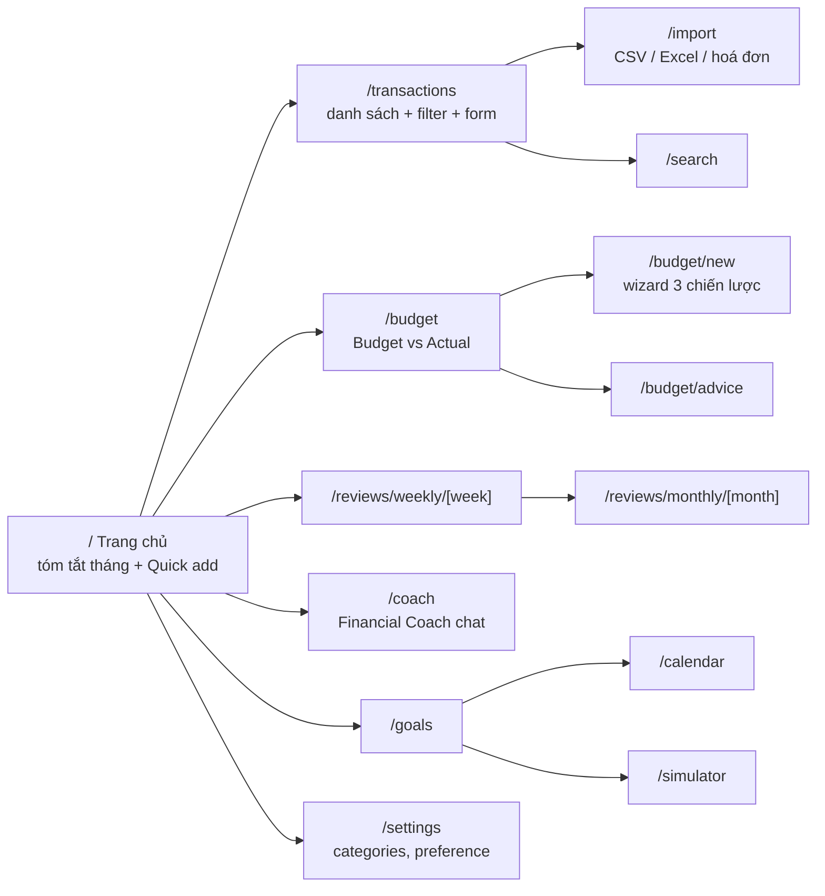

# Frontend Structure

Next.js App Router + TypeScript. Frontend **không** chứa logic tài chính: mọi con số đến từ backend.

## Bản đồ màn hình

| Route | Phase | Thành phần chính |
|---|---|---|
| `/` | 0 → mở rộng dần | Health status (P0), Quick add NL (P2: `QuickAddBox` → `TransactionDraftReview`), thẻ tóm tắt tháng (P5) |
| `/transactions` | 1 | `TransactionTable`, `TransactionForm`, filter tháng/category/type |
| `/settings` | 1, 3 | Quản lý category, danh sách preference đã học |
| `/budget/new` | 4 | `BudgetWizard` (chọn strategy → nhập số → preview) |
| `/budget` | 5, 9 | `BudgetVsActualTable`, drill-down giao dịch, badge zone |
| `/reviews/weekly/[week]` | 6 | `ReviewNarrative`, `ReflectionForm` |
| `/reviews/monthly/[month]` | 7 | Breakdown chart, narrative, reflection |
| `/budget/advice` | 8 | Thẻ advice: evidence + verdict + accept/dismiss |
| `/coach` | 10, 16 | Chat UI, hiển thị tool calls / nguồn trích dẫn |
| `/goals` | 11 | `GoalCard`, luồng "Nhận lương" PYF |
| `/calendar` | 12 | Lịch các khoản sắp tới + forecast balance |
| `/import` | 13, 14 | Upload hoá đơn, upload CSV + mapping + preview |
| `/search` | 15 | Ô tìm kiếm ngữ nghĩa |
| `/simulator` | 17 | Form kịch bản + chart before/after |

## Quy ước

- `src/lib/api.ts`: client fetch typed, base URL từ `NEXT_PUBLIC_API_BASE_URL`. Type sinh từ OpenAPI của FastAPI (`openapi-typescript`, `npm run gen:api` → `src/lib/api-types.ts`, commit file sinh ra).
- `src/hooks/use-api-data.ts`: đọc dữ liệu phía client (`useApiData(path)` → `{data, error, loading, reload}`). Trang là Server Component mỏng bọc Client Component; nếu component đọc thời gian hiện tại (vd. tháng mặc định) thì gọi `use(io())` và bọc `<Suspense>` (Next 16 Cache Components).
- `src/lib/format.ts`: `formatVND(amount)` dùng `Intl.NumberFormat('vi-VN', {style:'currency', currency:'VND'})`.
- `src/lib/amount.ts`: `parseAmountInput("1tr5")` — tiện ích gõ tắt số tiền trong form, backend vẫn nhận số nguyên.
- `src/components/transactions/transaction-fields.tsx`: `TransactionFields` + `validateTransactionValues` — bộ ô nhập giao dịch dùng chung cho dialog tạo/sửa (P1) và card draft AI (P2); truyền `className` để đổi layout (vd. lưới 2 cột).
- UI tiếng Việt; tên biến/component tiếng Anh theo [glossary](../product/glossary.md).
- Mọi kết quả AI hiển thị dưới dạng **draft có thể sửa** + nút xác nhận.
