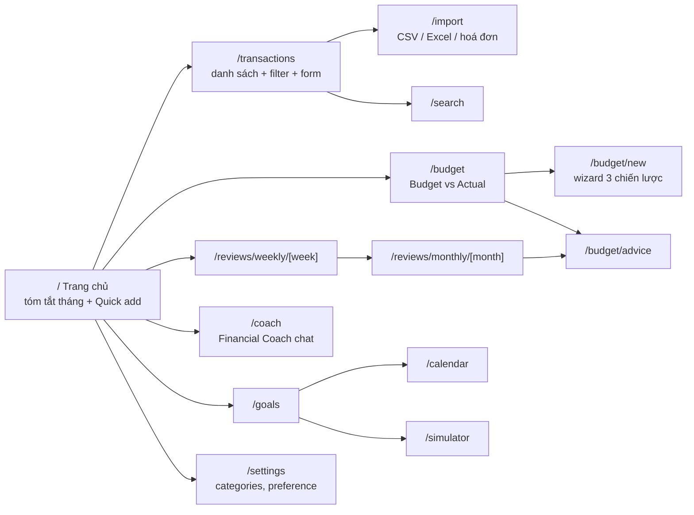

# Frontend Structure

Next.js App Router + TypeScript. Frontend **không** chứa logic tài chính: mọi con số đến từ backend.

## Bản đồ màn hình

| Route | Phase | Thành phần chính |
|---|---|---|
| `/` | 0 → mở rộng dần | Health status (P0), Quick add NL (P2: `QuickAddBox` → `TransactionDraftReview`; P3: badge "Theo sở thích đã học", thông báo "Đã học cách phân loại này"), P5: `HomeDashboard` = `QuickAddBox` + `HomeMonthSummary` (tải lại sau khi lưu giao dịch): `MonthSummaryCards` thu/chi/thu − chi tháng hiện tại (+ so với ngân sách) và `TopOverCard` (dòng vượt nhiều nhất + giao dịch gây vượt) từ `GET /dashboard/month-summary`; tháng chưa có budget → `BudgetEmptyState` (CTA tạo / copy tháng trước), budget nháp → nhắc kích hoạt. P6: `PendingWeeklyReviewBanner` trên cùng — chỉ Thứ Hai, gọi `GET /reviews/weekly/pending`, link tới review tuần trước (không tự tạo review); `?today=YYYY-MM-DD` để thử. P11: thu nhập lưu từ quick add có `pyf_proposal` → `PyfAllocationDialog` (nhiều thu nhập → lần lượt) |
| `/transactions` | 1, 11, 13, 14 | `TransactionTable`, `TransactionForm`, filter tháng/category/type (P14: + nguồn, lô import). P11: tạo thu nhập có `pyf_proposal` → mở `PyfAllocationDialog` |
| `/settings` | 1, 3 | Tab "Danh mục" (`CategoryManager`) và "Sở thích phân loại" (`PreferenceManager`: dạy AI bằng câu → draft → xác nhận, bảng preference đã học + xoá); tab lưu ở `?tab=categories\|preferences` |
| `/budget/new` | 4 | `BudgetWizard` (`?month=YYYY-MM`): tháng + thu nhập + chọn strategy (PYF: savings trước) hoặc "Copy tháng trước" → `AllocationPreviewTable` sửa từng dòng (tổng/cảnh báo/so sánh 50/30/20 do `POST /budgets/preview` tính, hook `useBudgetPreview`) → "Lưu nháp" / "Lưu & kích hoạt" |
| `/budget` | 4, 5, 9 | Chọn tháng (`?month=`); tháng chưa có budget → `BudgetEmptyState` (CTA tạo / copy tháng trước). Có budget → tabs (`?tab=track\|plan`, mặc định `plan` nếu nháp): **Theo dõi** (P5: `BudgetTracking` = `MonthSummaryCards` + `MonthProgressCard` + `BudgetVsActualTable` — planned/actual/còn lại-vượt/% đã dùng + vạch % tháng/nhịp/top contributor, badge `on_track` xanh · `ahead_of_pace` vàng · `over_budget` đỏ · `not_tracked` xám (savings); bấm dòng → `AllocationDrillDown` giao dịch của dòng; `?today=YYYY-MM-DD` đổi ngày tính pro-rata) và **Kế hoạch** (P4: `BudgetEditor` sửa planned, kích hoạt/đóng/xoá nháp). P9: tab Theo dõi tải thêm `GET /budgets/{id}/zones` → cột **Vùng** = `ZoneTooltip` (`ZoneBadge` 🟢 "Trong vùng thoải mái" · 🟡 "Đã vượt vùng thoải mái" · 🔴 "Vượt ngưỡng cảnh báo" · xám "Chưa tính vùng"; tooltip: chế độ Auto/Thủ công, ngưỡng, cách tính auto — số tháng/trung bình/độ lệch hoặc % dự phòng, ngưỡng cũ, mức pro-rata tới hôm nay) + nút `ZoneSettingsDialog` (Auto / Thủ công; thủ công nhập 3 ngưỡng, kiểm `thấp ≤ cao ≤ cảnh báo` trên client rồi `PATCH /budget-allocations/{id}/zone`; ngân sách đã đóng → khoá); `EarlyWarningLine` dưới tên dòng ("Đã dùng 80% ngân sách khi mới qua 48,4% tháng", từ backend); dòng auto chưa tính / ngưỡng cũ → khung nhắc + nút "Tính vùng tự động" (`POST /budgets/{id}/zones/recalculate`). Frontend không tự tính ngưỡng / zone |
| `/reviews/weekly` | 6 | `WeeklyReviewIndex`: lối tắt tuần trước / tuần này + danh sách review đã tạo (trạng thái, "Bản tự động"); link sang review tháng |
| `/reviews/weekly/[week]` | 6 | `WeeklyReviewPage` (`[week]` = Thứ Hai `YYYY-MM-DD`, ngày khác → link về Thứ Hai; điều hướng tuần trước/sau; `?today=`): chưa có → nút "Tạo review tuần này" (`POST /reviews/weekly`); có → `ReviewMetricCards` (chi/thu/% so với tuần trước/breakdown spending_type/tiến độ tuần), `ReviewNarrative` (Chuyện gì đã xảy ra / Vì sao / Điều đáng chú ý / Gợi ý, badge "Bản tóm tắt tự động" khi fallback), `HighlightList` (evidence: top danh mục, khoản lặp lại, khoản chi lớn), `ReflectionForm` + `FlagTransactionPicker` (tick khoản chi "không đáng tiền", đánh dấu "Lặp lại"); "Tạo lại" có confirm, giữ phản tư cũ |
| `/reviews/monthly` | 7 | `MonthlyReviewIndex`: lối tắt tháng trước / tháng này + danh sách review tháng (trạng thái, chi, tỉ lệ tiết kiệm) |
| `/reviews/monthly/[month]` | 7 | `MonthlyReviewPage` (`[month]` = `YYYY-MM`; điều hướng tháng trước/sau; `?today=`): chưa có → "Tạo review tháng" (`POST /reviews/monthly`); có → `MonthlySummaryCards` (Thu / Chi + chi thường xuyên vs bất thường / Tiết kiệm / Tỉ lệ tiết kiệm, so với tháng trước), `ReviewNarrative` ("Nhìn lại tháng"), `SpendingTypeChart` (Recharts: donut cơ cấu + cột so với tháng trước, chỉ vẽ số API), `IrregularItemsList`, `WeeklyReflectionDigest` (phản tư các tuần có Thứ Hai trong tháng), `BudgetActualMiniTable`, `HighlightList`, `ReflectionForm kind="monthly"` (tick khoản chi trong tháng, khoản bất thường gắn nhãn), CTA (P8) "Tạo tư vấn điều chỉnh" → `POST /budget/advice/generate` rồi chuyển `/budget/advice?month=YYYY-MM-01` (+ link "Xem tư vấn đã có"; tháng chưa có ngân sách đang theo dõi → chỉ link); "Tạo lại" có confirm |
| `/budget/advice` | 7 (chỗ đặt), 8 | P8: `BudgetAdvicePage` (`?month=YYYY-MM-01`, mặc định tháng trước; `?status=open\|accepted\|dismissed\|all`, mặc định `open`, kèm số đếm; `?today=`): "Tạo tư vấn điều chỉnh" (`POST /budget/advice/generate`) / "Tính lại tư vấn đang chờ" (`regenerate`), chưa có ngân sách đang theo dõi → link `/budget`; `BudgetAdviceList` → `AdviceCard` (badge verdict: `adjust_budget` "Budget có thể thấp hơn thực tế" · `one_off` "Khoản bất thường một lần" · `adjust_behavior` "Nên xem lại hành vi/nhịp chi" · `on_track` "Đang trong kế hoạch"; 3 tầng + nguồn AI/bản tự động; `EvidenceTable`: planned/actual/vượt, giao dịch ngoại lệ, thực chi 3 tháng, trung vị, CV, planned đề xuất); `AcceptAdviceDialog` chỉ cho `adjust_budget` đang chờ (xác nhận → `confirm: true`, áp dụng cho tháng sau; vượt thu nhập → tick xác nhận thêm); `DismissButton` (ghi chú tuỳ chọn); `AdvisorSettingsPanel` (`
`, ngưỡng `GET/PATCH /budget/advice/settings`). Verdict chỉ hiển thị, không tính ở frontend |
| `/coach` | 10, 16 | P10: `CoachPage` (`?session=<id>`, `?today=YYYY-MM-DD`; lưới 2 cột từ `lg`): `CoachSessionList` (cuộc trò chuyện mới, danh sách cập nhật gần nhất trước + đoạn đầu tin cuối, đổi tên inline, xoá có xác nhận) + `CoachChatWindow` (plain JSON, không stream; cuộc trò chuyện mới chỉ tạo session khi gửi câu đầu tiên — không tải lại khung chat; loading "Coach đang đọc dữ liệu..."; lỗi AI → khung lỗi theo mã `AI_*` + "Gửi lại", lỗi 5xx ghi chú câu hỏi đã lưu; `SuggestedQuestionChips` 3 câu gợi ý). `CoachMessageBubble`: `CoachAnswerText` (markdown tối giản: tiêu đề in đậm, gạch đầu dòng, link **nội bộ** `[nhãn](/đường-dẫn)`), `EvidenceTable` ("Dữ liệu đã dùng": mã E1…, danh mục / dòng, kỳ, chỉ số, số tiền), `ToolTracePanel` (`
`: tên tool + mô tả, tham số, tóm tắt kết quả, ms, mã evidence; không hiển thị prompt), dòng meta (badge guard + model · token · chi phí ước tính · thời gian). Không tự tính số. P16: `CitationList` dưới câu trả lời (`
` "Nguồn (n)": S1… tiêu đề — mục + đường dẫn tài liệu; mục "Nguồn:" trong văn bản được ẩn bằng `stripSourceSection` để không lặp) → bấm mở drawer (`Dialog`) hiện tiêu đề, mục, đường dẫn và toàn văn đoạn (`GET /knowledge/chunks/{id}`, lỗi → đoạn trích đã lưu); câu gợi ý thứ 4 "50/30/20 là gì, có phù hợp với tao không?"; nhãn tool `search_transactions`, `search_knowledge` |
| `/goals` | 11 | `GoalsPage` (`?today=YYYY-MM-DD`): thẻ "Cần để dành mỗi tháng" (tổng gợi ý của goal active) + "Phân bổ từ thu nhập" (`GET /goals/unallocated-incomes` — thu nhập từ đầu tháng trước chưa trích cho goal, nút "Phân bổ" → `POST /goals/pyf-proposal` → `PyfAllocationDialog`); lưới `GoalCard` (badge trạng thái Đang thực hiện / Tạm dừng / Đã đạt + Đúng / Chậm tiến độ, thanh tiến độ `progress_pct`, đã có / mục tiêu, còn thiếu, hạn + số tháng còn lại, gợi ý để dành / tháng; nút Thêm khoản góp (`ContributionDialog`, góp thủ công), Lịch sử (`ContributionTimeline`: số tiền, ngày, "Từ thu nhập: …" hoặc "Góp thủ công", xoá khoản góp), Sửa (`GoalFormDialog`: tên, số tiền gõ tắt `30tr`, hạn, ưu tiên), Tạm dừng / Tiếp tục, Xoá — 409 nếu đã có khoản góp mà chưa tạm dừng). `PyfAllocationDialog` ("Nhận lương", dùng chung cho `/goals`, `/transactions` và quick add trang chủ): 1. thu nhập đã lưu → 2. bảng mục tiêu (gợi ý / tháng, ô số tiền chỉnh được, còn thiếu sau) → 3. tiết kiệm ngân sách tháng (khi tháng có ngân sách) → 4. còn lại để chi tiêu; số user chỉnh được backend tính lại (`usePyfProposal`, debounce, cảnh báo vượt thu nhập / vượt phần còn thiếu khoá nút xác nhận) → "Xác nhận phân bổ" (`POST /goals/allocations`) / "Để sau" (không ghi gì). Frontend không tự tính tiền |
| `/calendar` | 12 | `CalendarPage` (`?today=YYYY-MM-DD`): `ForecastLineChart` (Recharts: đường số dư dự báo `GET /forecast?days=30\|60`, nút 30 / 60 ngày, đường đứt ngưỡng cảnh báo + chấm đỏ ngày đầu tiên dưới ngưỡng, thẻ Đầu kỳ / Thấp nhất / Cuối kỳ / Chi biến đổi mỗi ngày, cảnh báo 3 tầng không phán xét, ghi chú "chưa nhập số dư", `insufficient_history`, khoản quá hạn chưa tính) + `ForecastSettingsCard` (số dư hiện có — ghi rõ là giả định, cho phép 0 / âm; "tính tại đầu ngày"; ngưỡng cảnh báo; ngày để dành mục tiêu → `PATCH /settings/forecast`); `CalendarMonthView` (lưới tháng T2–CN, icon 💰 thu · 🏠 nhà · 💳 thẻ tín dụng · 📱 internet / tiện ích · 🎯 để dành mục tiêu · 🔁 khác, mờ = đã ghi, viền đỏ = quá hạn; điều hướng tháng; danh sách sự kiện + tổng thu / chi / để dành từ `GET /calendar/month`); `UpcomingList` (khoản đang bật đến hạn ≤ 14 ngày hoặc quá hạn, nút "Tạo giao dịch" → `POST /recurring-transactions/{id}/create-transaction`, dòng trạng thái + link `/transactions`; thu nhập có `pyf_proposal` → `PyfAllocationDialog`); `RecurringManager` (bảng khoản định kỳ: lịch, kỳ tới + trạng thái, sửa, tạm dừng / bật lại) + `RecurringFormDialog` (thu / chi, danh mục, loại chi tiêu, số tiền gõ tắt, lặp lại hằng tháng / tuần / năm, ngày trong tháng hoặc thứ, kỳ tới tuỳ chọn); `RecurringSuggestionPanel` ("Phát hiện từ lịch sử" → `POST /recurring-transactions/detect`, đề xuất kèm số lần / số tiền / độ tin cậy, "Xác nhận" / "Bỏ qua"; đề xuất cũ đọc `GET /recurring-transactions/suggestions`). Frontend không tự tính tiền / lịch đến hạn |
| `/import` | 13, 14 | P13: `ImportPage` (tab lưu ở `?tab=`; tab "Hoá đơn", tab "Sao kê CSV / Excel" khoá tới Phase 14) → `ReceiptImportPanel`: `ReceiptUploadDropzone` (kéo thả / chọn 1 ảnh, kiểm tra JPEG/PNG/WEBP/HEIC + ≤ 10MB phía client, thanh tiến độ upload qua `XMLHttpRequest` rồi "AI đang đọc hoá đơn…", ghi chú quyền riêng tư dưới vùng thả) → `ReceiptPreview` (object URL local; HEIC xem bằng ảnh backend `GET /receipts/{id}/file` đã đổi JPEG) + `ReceiptExtractionPanel` (badge trạng thái + độ tin cậy, cửa hàng / ngày / tổng / số dòng, bảng dòng hàng, cảnh báo backend; `failed` → lý do + "Đọc lại" (`POST /receipts/{id}/retry`) + "Nhập thủ công từ ảnh này") + `ReceiptDraftForm` (`TransactionFields` điền từ `transaction_draft` hoặc `manual_prefill`, badge "Theo sở thích đã học", "Lưu giao dịch" → `POST /receipts/{id}/confirm`; thành công → link `/transactions?month=YYYY-MM`, thông báo sở thích vừa học, thu nhập có `pyf_proposal` → `PyfAllocationDialog`); `ReceiptHistoryTable` (`GET /receipts?status=&limit=20`, lọc trạng thái, link giao dịch, "Xem" mở lại chi tiết). Lib `src/lib/receipts.ts`. P14: tab "Sao kê CSV / Excel" (`?tab=csv`) → `CsvImportPanel`: `ImportUploadForm` (tên ngân hàng tuỳ chọn + gợi ý từ `GET /imports/mapping-profiles`, kéo thả / chọn 1 file `.csv` / `.xlsx`, kiểm tra đuôi + ≤ 10MB phía client, tiến độ XHR `lib/imports.uploadImport`, ghi chú quyền riêng tư) → thẻ preview (tên file / ngân hàng, bảng mã, dấu phân cách, sheet, dòng tiêu đề, badge tổng / hợp lệ / trùng / lỗi / theo sở thích / AI / chưa phân loại, cảnh báo backend) → `ImportMappingEditor` (5 trường → cột trong file, định dạng ngày, kiểu số tiền, cảnh báo thiếu cột, "Áp dụng mapping" → `PATCH /imports/{id}/mapping`) → `ImportPreviewTable` (lọc theo nội dung không dấu + trạng thái Hợp lệ / Cần xem lại / Trùng / Lỗi; checkbox = dòng sẽ nhập, dòng trùng / lỗi bị khoá, dòng chuyển khoản nội bộ / có thể trùng nhập tay mặc định bỏ chọn; sửa ghi chú, danh mục (lọc theo thu / chi) + loại chi tiêu từng dòng bằng `<select>` gốc; sửa hàng loạt danh mục / loại cho dòng đang chọn **trong danh sách đã lọc**; badge trạng thái + độ tin cậy + lý do / cảnh báo; 100 dòng / lần "Hiện thêm") → "Nhập N giao dịch" (`POST /imports/{id}/commit`) → tóm tắt đã nhập / bỏ qua trùng / lỗi / bỏ chọn + link `/transactions?source=import&import_batch_id=…`; 409 → "File này đã được import" + link, không có nút nhập. Lib `src/lib/imports.ts`. `/transactions` nhận `?month=YYYY-MM`, `?source=`, `?import_batch_id=` (lọc theo lô, bỏ lọc tháng, chip "Bỏ lọc"), bộ lọc "Nguồn", nút "Nhập từ hoá đơn" / "Nhập sao kê"; bảng giao dịch có badge 🧾 "Hoá đơn" / "Import". Nav "Nhập dữ liệu" |
| `/search` | 15 | `SearchPage` (trạng thái trên URL `?q=&from=&to=&limit=10\|20\|50`): ô tìm + từ / đến ngày + số kết quả + nút nhanh Tháng này / Tháng trước / Mọi lúc; chưa nhập → ví dụ ("ăn ngoài", "đi lại", "cà phê", "khoản lớn mua sắm"); kết quả → thẻ Kết quả / Tổng chi / Tổng thu / Thu − chi (số từ API), dòng chưa lập chỉ mục → nút "Lập chỉ mục ngay" (`POST /search/transactions/reindex`), danh sách (ngày, ghi chú, lý do khớp + điểm, badge danh mục, số tiền) → bấm mở dialog chi tiết + link `/transactions?month=YYYY-MM&q=<ghi chú>`; 503 → thông báo AI chưa dùng được + link Giao dịch. `/transactions` nhận thêm `?q=`. Nav "Tìm kiếm" |
| `/simulator` | 17 | Form kịch bản + chart before/after |

## Quy ước

- `src/lib/api.ts`: client fetch typed, base URL từ `NEXT_PUBLIC_API_BASE_URL`. Type sinh từ OpenAPI của FastAPI (`openapi-typescript`, `npm run gen:api` → `src/lib/api-types.ts`, commit file sinh ra).
- `src/hooks/use-api-data.ts`: đọc dữ liệu phía client (`useApiData(path)` → `{data, error, loading, reload}`). Trang là Server Component mỏng bọc Client Component; nếu component đọc thời gian hiện tại (vd. tháng mặc định) thì gọi `use(io())` và bọc `<Suspense>` (Next 16 Cache Components). Component dùng `useSearchParams` (vd. `SettingsTabs`) cũng phải bọc `<Suspense>`.
- `src/lib/format.ts`: `formatVND(amount)` dùng `Intl.NumberFormat('vi-VN', {style:'currency', currency:'VND'})`.
- Biểu đồ: **Recharts 3** (Phase 7), chỉ trong Client Component; dữ liệu và % lấy nguyên từ API, màu theo `SPENDING_TYPE_COLORS` (`src/lib/labels.ts`).
- Tooltip: `src/components/ui/tooltip.tsx` (shadcn base-nova trên Base UI, Phase 9) — bọc vùng dùng bằng `TooltipProvider`; trigger nằm trong dòng bảng bấm được thì `stopPropagation`.
- `src/lib/amount.ts`: `parseAmountInput("1tr5")` — tiện ích gõ tắt số tiền trong form, backend vẫn nhận số nguyên.
- `src/components/transactions/transaction-fields.tsx`: `TransactionFields` + `validateTransactionValues` — bộ ô nhập giao dịch dùng chung cho dialog tạo/sửa (P1) và card draft AI (P2); truyền `className` để đổi layout (vd. lưới 2 cột).
- UI tiếng Việt; tên biến/component tiếng Anh theo [glossary](../product/glossary.md).
- Mọi kết quả AI hiển thị dưới dạng **draft có thể sửa** + nút xác nhận.
