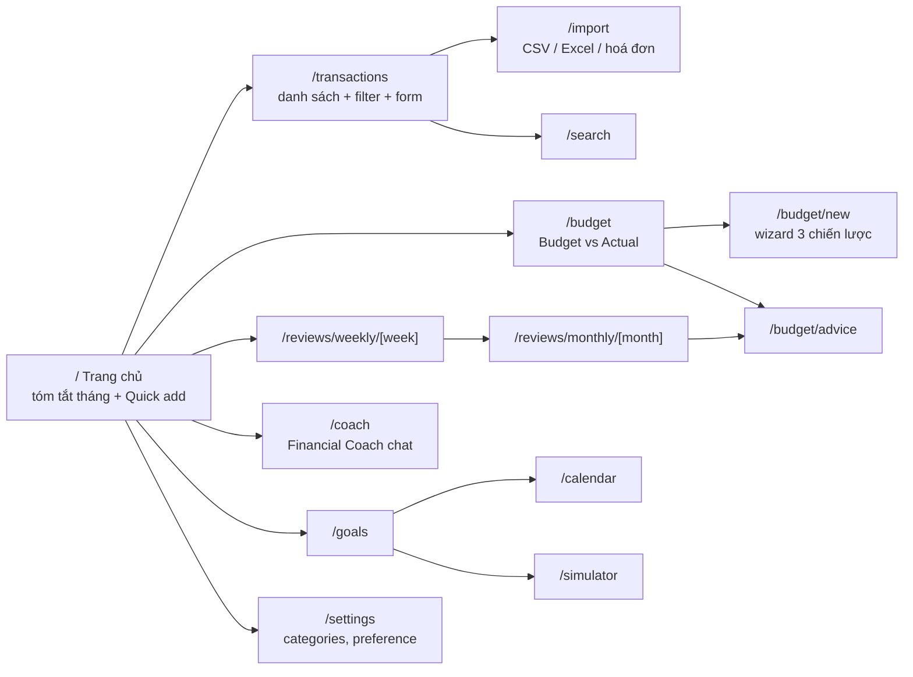

# Frontend Structure

Next.js App Router + TypeScript. Frontend **không** chứa logic tài chính: mọi con số đến từ backend.

## Bản đồ màn hình

| Route | Phase | Thành phần chính |
|---|---|---|
| `/` | 0 → mở rộng dần | Health status (P0), Quick add NL (P2: `QuickAddBox` → `TransactionDraftReview`; P3: badge "Theo sở thích đã học", thông báo "Đã học cách phân loại này"), P5: `HomeDashboard` = `QuickAddBox` + `HomeMonthSummary` (tải lại sau khi lưu giao dịch): `MonthSummaryCards` thu/chi/thu − chi tháng hiện tại (+ so với ngân sách) và `TopOverCard` (dòng vượt nhiều nhất + giao dịch gây vượt) từ `GET /dashboard/month-summary`; tháng chưa có budget → `BudgetEmptyState` (CTA tạo / copy tháng trước), budget nháp → nhắc kích hoạt. P6: `PendingWeeklyReviewBanner` trên cùng — chỉ Thứ Hai, gọi `GET /reviews/weekly/pending`, link tới review tuần trước (không tự tạo review); `?today=YYYY-MM-DD` để thử |
| `/transactions` | 1 | `TransactionTable`, `TransactionForm`, filter tháng/category/type |
| `/settings` | 1, 3 | Tab "Danh mục" (`CategoryManager`) và "Sở thích phân loại" (`PreferenceManager`: dạy AI bằng câu → draft → xác nhận, bảng preference đã học + xoá); tab lưu ở `?tab=categories\|preferences` |
| `/budget/new` | 4 | `BudgetWizard` (`?month=YYYY-MM`): tháng + thu nhập + chọn strategy (PYF: savings trước) hoặc "Copy tháng trước" → `AllocationPreviewTable` sửa từng dòng (tổng/cảnh báo/so sánh 50/30/20 do `POST /budgets/preview` tính, hook `useBudgetPreview`) → "Lưu nháp" / "Lưu & kích hoạt" |
| `/budget` | 4, 5, 9 | Chọn tháng (`?month=`); tháng chưa có budget → `BudgetEmptyState` (CTA tạo / copy tháng trước). Có budget → tabs (`?tab=track\|plan`, mặc định `plan` nếu nháp): **Theo dõi** (P5: `BudgetTracking` = `MonthSummaryCards` + `MonthProgressCard` + `BudgetVsActualTable` — planned/actual/còn lại-vượt/% đã dùng + vạch % tháng/nhịp/top contributor, badge `on_track` xanh · `ahead_of_pace` vàng · `over_budget` đỏ · `not_tracked` xám (savings); bấm dòng → `AllocationDrillDown` giao dịch của dòng; `?today=YYYY-MM-DD` đổi ngày tính pro-rata) và **Kế hoạch** (P4: `BudgetEditor` sửa planned, kích hoạt/đóng/xoá nháp). P9: badge zone |
| `/reviews/weekly` | 6 | `WeeklyReviewIndex`: lối tắt tuần trước / tuần này + danh sách review đã tạo (trạng thái, "Bản tự động"); link sang review tháng |
| `/reviews/weekly/[week]` | 6 | `WeeklyReviewPage` (`[week]` = Thứ Hai `YYYY-MM-DD`, ngày khác → link về Thứ Hai; điều hướng tuần trước/sau; `?today=`): chưa có → nút "Tạo review tuần này" (`POST /reviews/weekly`); có → `ReviewMetricCards` (chi/thu/% so với tuần trước/breakdown spending_type/tiến độ tuần), `ReviewNarrative` (Chuyện gì đã xảy ra / Vì sao / Điều đáng chú ý / Gợi ý, badge "Bản tóm tắt tự động" khi fallback), `HighlightList` (evidence: top danh mục, khoản lặp lại, khoản chi lớn), `ReflectionForm` + `FlagTransactionPicker` (tick khoản chi "không đáng tiền", đánh dấu "Lặp lại"); "Tạo lại" có confirm, giữ phản tư cũ |
| `/reviews/monthly` | 7 | `MonthlyReviewIndex`: lối tắt tháng trước / tháng này + danh sách review tháng (trạng thái, chi, tỉ lệ tiết kiệm) |
| `/reviews/monthly/[month]` | 7 | `MonthlyReviewPage` (`[month]` = `YYYY-MM`; điều hướng tháng trước/sau; `?today=`): chưa có → "Tạo review tháng" (`POST /reviews/monthly`); có → `MonthlySummaryCards` (Thu / Chi + chi thường xuyên vs bất thường / Tiết kiệm / Tỉ lệ tiết kiệm, so với tháng trước), `ReviewNarrative` ("Nhìn lại tháng"), `SpendingTypeChart` (Recharts: donut cơ cấu + cột so với tháng trước, chỉ vẽ số API), `IrregularItemsList`, `WeeklyReflectionDigest` (phản tư các tuần có Thứ Hai trong tháng), `BudgetActualMiniTable`, `HighlightList`, `ReflectionForm kind="monthly"` (tick khoản chi trong tháng, khoản bất thường gắn nhãn), CTA "Xem tư vấn điều chỉnh ngân sách" → `/budget/advice?month=YYYY-MM-01`; "Tạo lại" có confirm |
| `/budget/advice` | 7 (chỗ đặt), 8 | P7: trang giữ chỗ "Sắp có (Phase 8)" nhận `?month=YYYY-MM-01`, link quay lại review tháng / ngân sách. P8: thẻ advice: evidence + verdict + accept/dismiss |
| `/coach` | 10, 16 | Chat UI, hiển thị tool calls / nguồn trích dẫn |
| `/goals` | 11 | `GoalCard`, luồng "Nhận lương" PYF |
| `/calendar` | 12 | Lịch các khoản sắp tới + forecast balance |
| `/import` | 13, 14 | Upload hoá đơn, upload CSV + mapping + preview |
| `/search` | 15 | Ô tìm kiếm ngữ nghĩa |
| `/simulator` | 17 | Form kịch bản + chart before/after |

## Quy ước

- `src/lib/api.ts`: client fetch typed, base URL từ `NEXT_PUBLIC_API_BASE_URL`. Type sinh từ OpenAPI của FastAPI (`openapi-typescript`, `npm run gen:api` → `src/lib/api-types.ts`, commit file sinh ra).
- `src/hooks/use-api-data.ts`: đọc dữ liệu phía client (`useApiData(path)` → `{data, error, loading, reload}`). Trang là Server Component mỏng bọc Client Component; nếu component đọc thời gian hiện tại (vd. tháng mặc định) thì gọi `use(io())` và bọc `<Suspense>` (Next 16 Cache Components). Component dùng `useSearchParams` (vd. `SettingsTabs`) cũng phải bọc `<Suspense>`.
- `src/lib/format.ts`: `formatVND(amount)` dùng `Intl.NumberFormat('vi-VN', {style:'currency', currency:'VND'})`.
- Biểu đồ: **Recharts 3** (Phase 7), chỉ trong Client Component; dữ liệu và % lấy nguyên từ API, màu theo `SPENDING_TYPE_COLORS` (`src/lib/labels.ts`).
- `src/lib/amount.ts`: `parseAmountInput("1tr5")` — tiện ích gõ tắt số tiền trong form, backend vẫn nhận số nguyên.
- `src/components/transactions/transaction-fields.tsx`: `TransactionFields` + `validateTransactionValues` — bộ ô nhập giao dịch dùng chung cho dialog tạo/sửa (P1) và card draft AI (P2); truyền `className` để đổi layout (vd. lưới 2 cột).
- UI tiếng Việt; tên biến/component tiếng Anh theo [glossary](../product/glossary.md).
- Mọi kết quả AI hiển thị dưới dạng **draft có thể sửa** + nút xác nhận.
