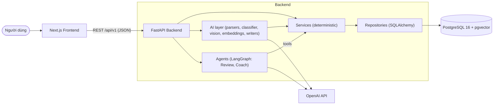

# Architecture Overview

## Nguyên tắc kiến trúc

1. **Lõi deterministic, AI ở lớp trên** ([ADR-005](./decisions/ADR-005-deterministic-core-ai-layer.md)).
   Mọi con số (tổng chi, variance, % breakdown, forecast) được tính bằng code Python + SQL, có unit test.
   AI chỉ: hiểu input tự nhiên → đề xuất có cấu trúc, diễn giải số liệu đã tính sẵn, gọi tool để lấy số liệu. **AI không bao giờ tự tính tiền rồi ghi vào DB.**
2. **Human-in-the-loop cho mọi ghi dữ liệu từ AI.** AI tạo *draft* (giao dịch, phân loại, budget advice), user xác nhận mới lưu.
3. **Review là trung tâm** — dashboard chỉ là đầu vào cho review.
4. **AI 3 tầng:** Observation → Explanation → Action. Giọng văn trung lập, không phán xét, không ra lệnh.
5. **Single-user trước**, schema chừa `user_id` ([ADR-004](./decisions/ADR-004-single-user-first.md)).

## Bản đồ tài liệu kiến trúc

| Tài liệu | Trả lời câu hỏi |
|---|---|
| [system-context.md](./system-context.md) | Hệ thống tương tác với ai / cái gì? |
| [containers.md](./containers.md) | Gồm những process/service nào, giao tiếp ra sao? |
| [backend-components.md](./backend-components.md) | Backend chia module thế nào, quy tắc phụ thuộc? |
| [frontend-structure.md](./frontend-structure.md) | Các màn hình, route, cách gọi API? |
| [data-model.md](./data-model.md) | Bảng nào, quan hệ gì, phase nào tạo? |
| [core-loop.md](./core-loop.md) | Luồng nghiệp vụ chính của sản phẩm? |
| [ai-architecture.md](./ai-architecture.md) | AI được dùng ở đâu, model nào, LangGraph graph ra sao? |
| [sequences.md](./sequences.md) | Các luồng quan trọng chạy theo thứ tự nào? |
| [budget-adjustment.md](./budget-adjustment.md) | Logic "budget sai hay hành vi sai" + vùng 🟢🟡🔴? |
| [phase-roadmap.md](./phase-roadmap.md) | Phase nào phụ thuộc phase nào? |
| [decisions/](./decisions/) | Vì sao chọn công nghệ/thiết kế này? (ADR) |

## Tổng quan một hình



Vận hành (Phase 18): mọi lời gọi OpenAI đi qua `ai/openai_client.py` và được ghi vào `ai_call_logs`
(token, chi phí ước tính, latency, trạng thái — không lưu nội dung) → xem ở `/settings?tab=ai-usage`.
Lỗi API luôn có dạng `{"detail", "code"}` (kể cả 404/405/500). Cả stack chạy được bằng
`docker compose up -d --build`; CI GitHub Actions chạy ruff + pytest (không AI) + frontend lint/typecheck/build.

## Cấu trúc repo đích

```
AI-personal-finance-assistant/
├── backend/
│   ├── app/
│   │   ├── main.py
│   │   ├── core/            # config, db session, logging, errors
│   │   ├── models/          # SQLAlchemy ORM
│   │   ├── schemas/         # Pydantic request/response + AI structured output
│   │   ├── repositories/    # truy vấn DB
│   │   ├── services/        # business logic deterministic
│   │   ├── ai/              # OpenAI client, prompts, parsers, classifier, vision, embeddings
│   │   ├── agents/          # LangGraph graphs + tools
│   │   └── api/routers/     # FastAPI routers
│   ├── alembic/
│   ├── knowledge/           # bài viết kiến thức tài chính cho RAG (Phase 16)
│   ├── tests/
│   │   ├── unit/
│   │   ├── api/
│   │   └── ai_golden/       # golden test set cho tính năng AI (chạy có API key)
│   ├── Dockerfile
│   └── pyproject.toml
├── frontend/
│   ├── src/app/             # Next.js App Router pages
│   ├── src/components/
│   ├── src/lib/api.ts       # API client typed
│   └── Dockerfile
├── docs/
├── .github/workflows/ci.yml
└── docker-compose.yml       # db + backend + frontend
```
