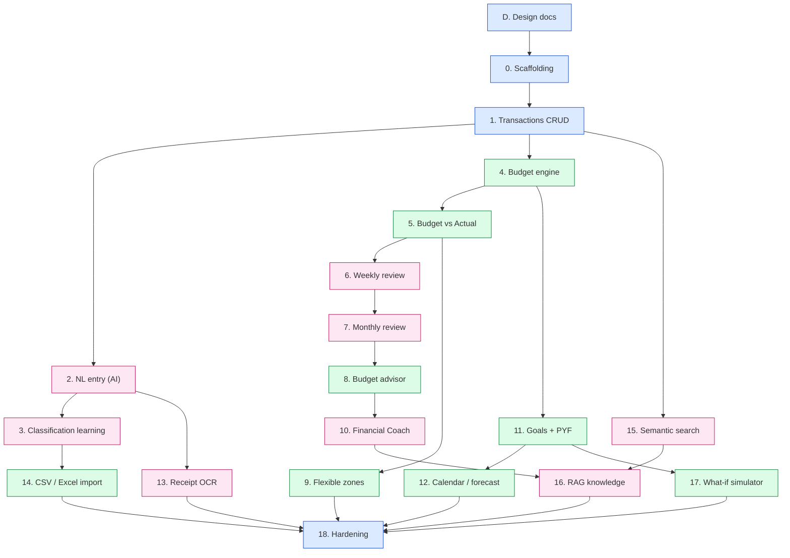

# Phase Roadmap

## Đồ thị phụ thuộc

Mũi tên `A --> B` nghĩa là **B cần A xong trước**.

Chú thích màu: xanh dương = nền tảng, hồng = trọng tâm AI, xanh lá = nghiệp vụ tài chính / dữ liệu.

## Thứ tự làm khuyến nghị (tuần tự, 1 người)

| # | Phase | Milestone sau phase |
|---|---|---|
| 1 | [D](../phases/phase-D-design-docs.md) | Có tài liệu thiết kế |
| 2 | [0](../phases/phase-00-scaffolding.md) | App rỗng chạy end-to-end |
| 3 | [1](../phases/phase-01-transactions.md) | **M1 — Ghi chép thủ công dùng được** |
| 4 | [2](../phases/phase-02-nl-entry.md) | Nhập bằng câu tự nhiên |
| 5 | [3](../phases/phase-03-classification-learning.md) | **M2 — Tracking loop hoàn chỉnh** |
| 6 | [4](../phases/phase-04-budget-engine.md) | Có budget |
| 7 | [5](../phases/phase-05-budget-vs-actual.md) | **M3 — Budget loop hoàn chỉnh** |
| 8 | [6](../phases/phase-06-weekly-review.md) | Review tuần |
| 9 | [7](../phases/phase-07-monthly-review.md) | **M4 — Review loop (MVP sản phẩm)** |
| 10 | [8](../phases/phase-08-budget-advisor.md) | Tư vấn điều chỉnh |
| 11 | [9](../phases/phase-09-flexible-zones.md) | Budget linh hoạt |
| 12 | [10](../phases/phase-10-financial-coach.md) | **M5 — AI Agent** |
| 13 | [11](../phases/phase-11-goals-pyf.md) | Goals + PYF |
| 14 | [12](../phases/phase-12-calendar-forecast.md) | Lịch dòng tiền |
| 15 | [13](../phases/phase-13-receipt-ocr.md) | OCR hoá đơn |
| 16 | [14](../phases/phase-14-csv-import.md) | Import sao kê |
| 17 | [15](../phases/phase-15-semantic-search.md) | Semantic search |
| 18 | [16](../phases/phase-16-rag-knowledge.md) | **M6 — Full AI curriculum** |
| 19 | [17](../phases/phase-17-whatif-simulator.md) | What-if (stretch) |
| 20 | [18](../phases/phase-18-hardening.md) | **M7 — Hoàn thiện** |

Các nhánh song song nếu muốn đổi thứ tự: sau Phase 2 có thể làm 13 bất kỳ lúc nào; sau Phase 1 có thể làm 15; sau Phase 4 có thể làm 11 → 12/17.
