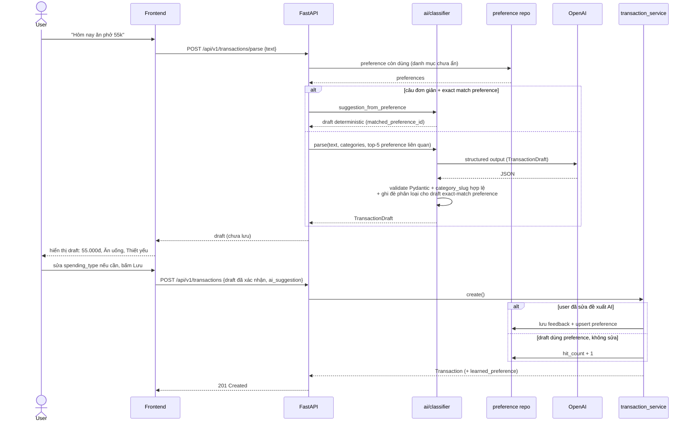
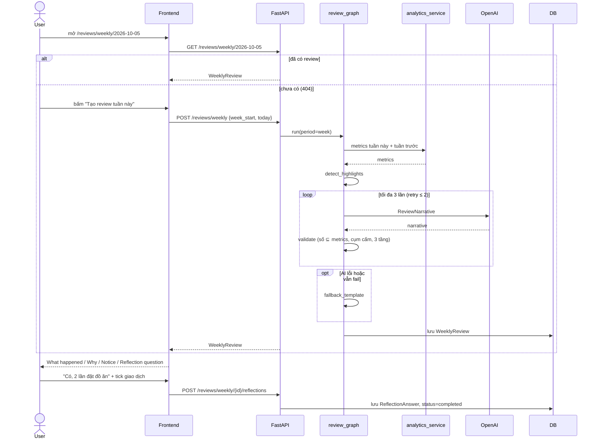
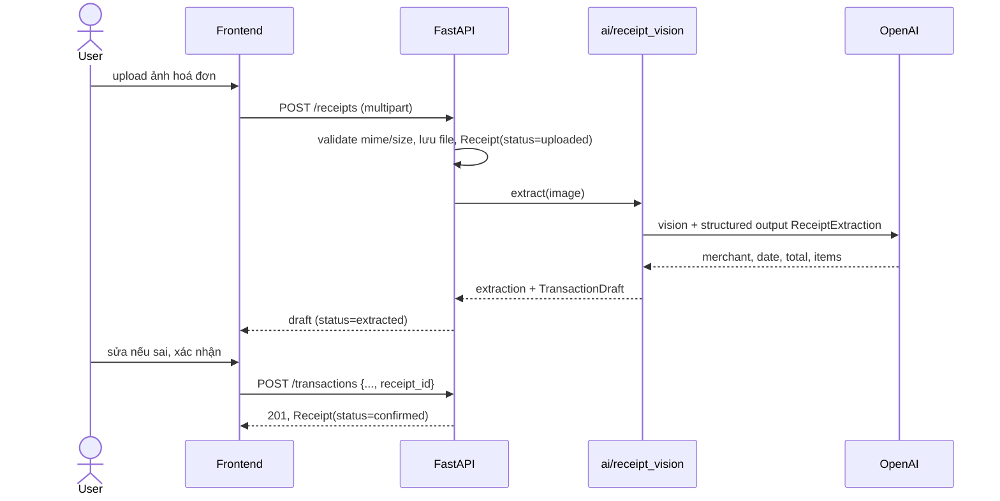
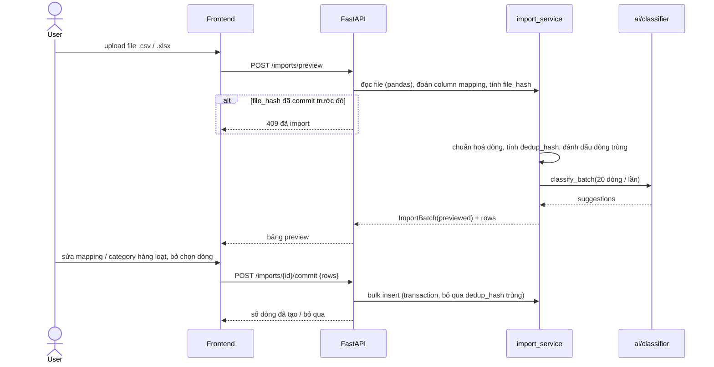
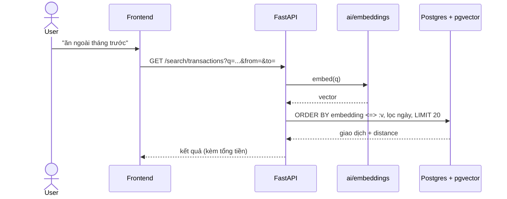

# Sequence Diagrams

## 1. Nhập giao dịch bằng câu tự nhiên (Phase 2, 3)

> Bước tra cứu `PREF` và lưu feedback/preference chỉ có từ **Phase 3**. Ở Phase 2 bỏ qua các bước này (classifier nhận danh sách preference rỗng).
> Phase 3: nếu câu đơn giản (1 khoản tiền, không nêu ngày) khớp exact một preference thì API trả draft deterministic **không gọi OpenAI**; ngược lại gọi OpenAI với top-5 preference liên quan rồi hậu kiểm draft theo preference. Parse không ghi DB; `hit_count` chỉ tăng khi user lưu draft dùng preference mà không sửa.



## 2. Nhận lương → Pay Yourself First → Goal (Phase 11)

```mermaid
sequenceDiagram
    actor U as User
    participant FE as Frontend
    participant API as FastAPI
    participant GS as goal_service
    participant BR as budget_repository
    participant TX as transaction_service

    U->>FE: "Nhận lương 25 triệu" (quick add) hoặc form /transactions
    FE->>API: POST /transactions/parse (quick add)
    API-->>FE: draft income 25.000.000
    FE->>API: POST /transactions (income)
    API->>TX: create income (commit)
    API->>GS: proposal_for_new_income(income) — chỉ đọc
    GS->>BR: budget tháng của thu nhập (savings_target, strategy)
    GS-->>API: goal active theo priority: Laptop 4.400.000 → savings 5.000.000 → available 15.600.000
    API-->>FE: 201 + pyf_proposal (null nếu không có goal active và budget không phải pyf)
    FE-->>U: dialog "Nhận lương" (thu nhập · mục tiêu · tiết kiệm ngân sách · còn lại để chi tiêu)
    U->>FE: chỉnh số
    FE->>API: POST /goals/pyf-proposal {income_transaction_id, items, budget_savings_amount} (debounce)
    API->>GS: tính lại phần còn thiếu / available / cảnh báo — không ghi DB
    U->>FE: xác nhận
    FE->>API: POST /goals/allocations {income_transaction_id, items, budget_savings_amount}
    API->>GS: validate (thu nhập, chưa phân bổ, goal active, ≤ còn thiếu, tổng ≤ thu nhập) → create GoalContribution(s) (1 commit)
    API-->>FE: contributions + available_spending
    Note over FE,API: Đóng dialog chưa xác nhận → thu nhập vẫn còn, không có khoản góp;<br/>/goals liệt kê "Phân bổ từ thu nhập" (GET /goals/unallocated-incomes)
```

## 3. Weekly Review (Phase 6)



## 4. Financial Coach: "Tao nên giảm khoản nào?" (Phase 10)

```mermaid
sequenceDiagram
    actor U as User
    participant FE as Frontend
    participant API as FastAPI
    participant AG as coach_graph
    participant T as tools
    participant OAI as OpenAI

    U->>FE: "Tao nên giảm khoản nào?"
    FE->>API: POST /coach/sessions/{id}/messages
    API->>API: lưu user message (commit)
    API->>AG: invoke(history + message)
    AG->>AG: scope_check (ngoài phạm vi / yêu cầu ghi → template)
    AG->>OAI: messages + tool schemas
    OAI-->>AG: tool_call get_category_trend(months=3) + get_budget_status()
    AG->>T: get_category_trend(3)
    T-->>AG: Ăn uống 4.2tr, Mua sắm 3.8tr (biến động cao nhất)...
    AG->>T: get_budget_status
    T-->>AG: variance theo dòng ngân sách
    AG->>OAI: kết quả tool
    OAI-->>AG: câu trả lời: evidence + gợi ý có điều kiện
    AG->>AG: response_guard (số ⊆ output tool, giọng văn; sai → viết lại 1 lần)
    AG-->>API: message + tool trace + evidence + token/cost
    API->>API: lưu assistant message
    API-->>FE: JSON (plain, chưa stream ở Phase 10)
    FE-->>U: câu trả lời + bảng "Dữ liệu đã dùng" + tool trace
```

## 5. Đọc hoá đơn (Phase 13)



## 6. Import sao kê CSV (Phase 14)



## 7. Tìm kiếm ngữ nghĩa (Phase 15)


