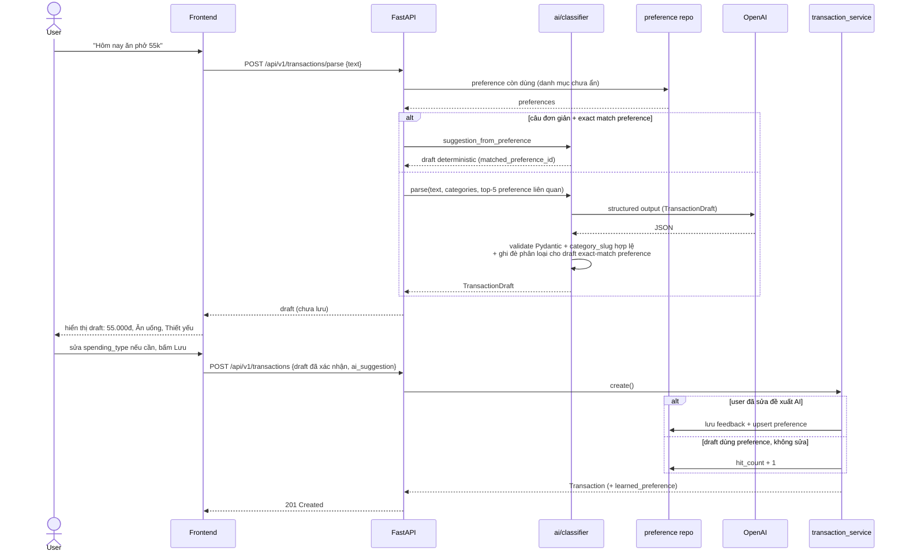
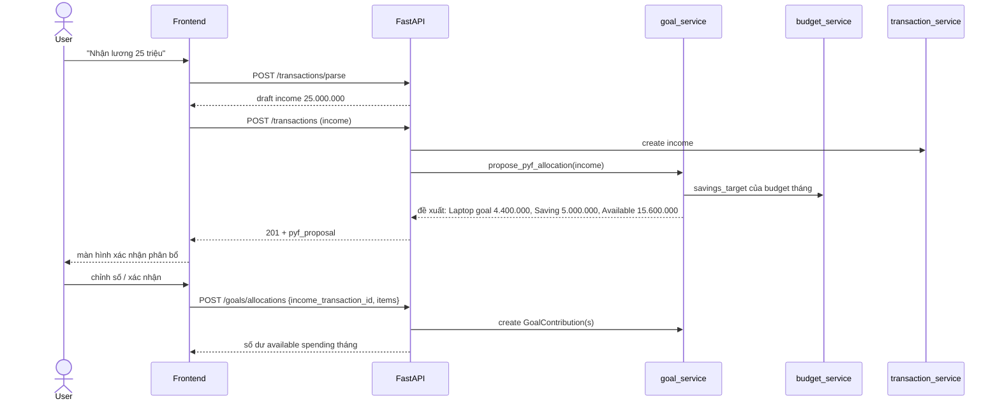
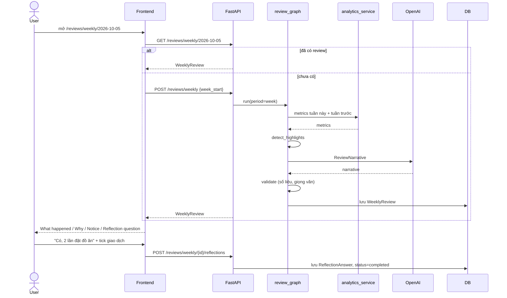
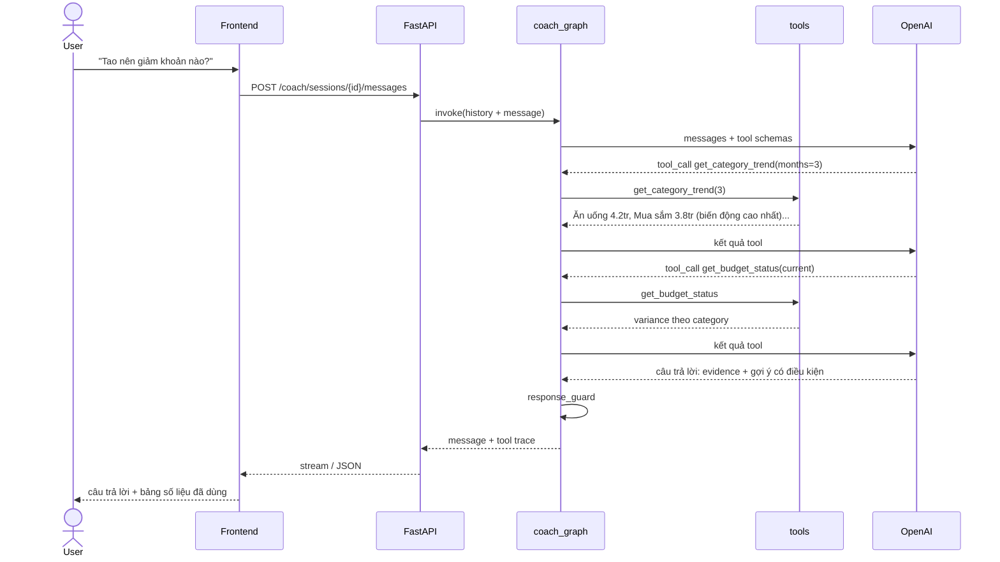
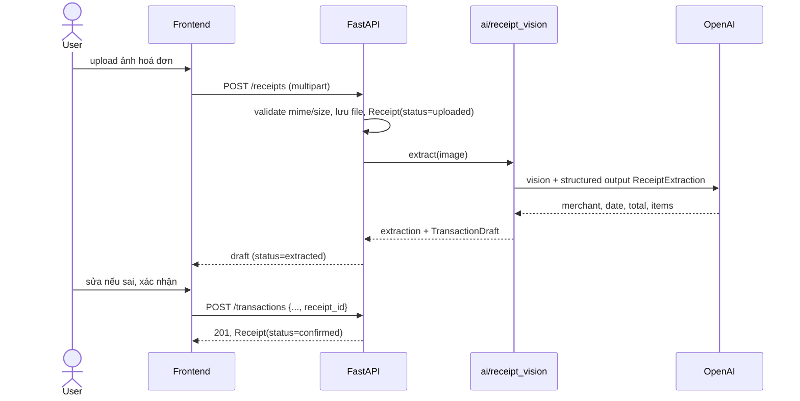
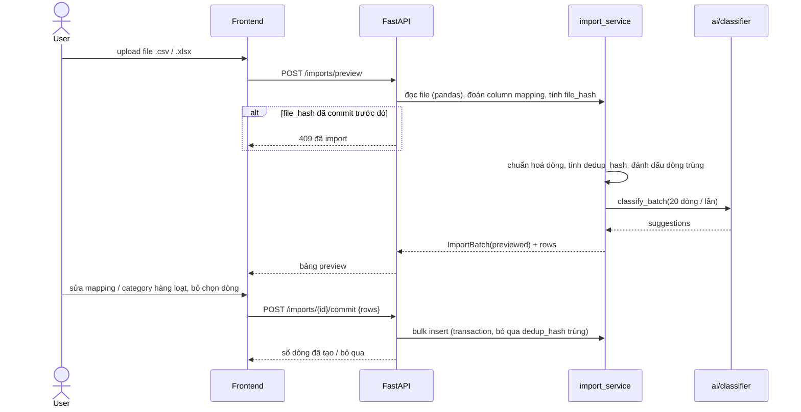
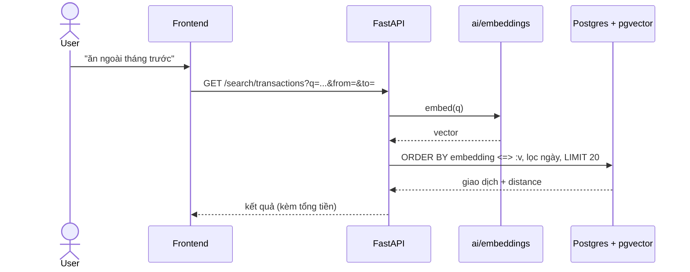

# Sequence Diagrams

## 1. Nhập giao dịch bằng câu tự nhiên (Phase 2, 3)

> Bước tra cứu `PREF` và lưu feedback/preference chỉ có từ **Phase 3**. Ở Phase 2 bỏ qua các bước này (classifier nhận danh sách preference rỗng).
> Phase 3: nếu câu đơn giản (1 khoản tiền, không nêu ngày) khớp exact một preference thì API trả draft deterministic **không gọi OpenAI**; ngược lại gọi OpenAI với top-5 preference liên quan rồi hậu kiểm draft theo preference. Parse không ghi DB; `hit_count` chỉ tăng khi user lưu draft dùng preference mà không sửa.

## 2. Nhận lương → Pay Yourself First → Goal (Phase 11)

## 3. Weekly Review (Phase 6)

## 4. Financial Coach: "Tao nên giảm khoản nào?" (Phase 10)

## 5. Đọc hoá đơn (Phase 13)

## 6. Import sao kê CSV (Phase 14)

## 7. Tìm kiếm ngữ nghĩa (Phase 15)

