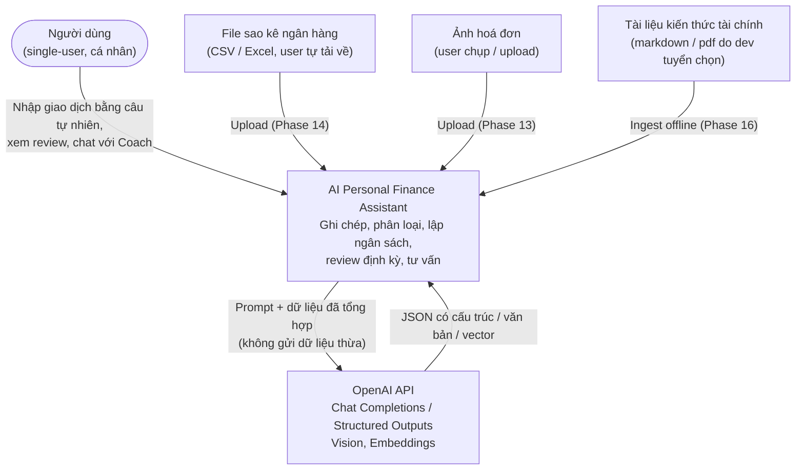

# System Context (C4 Level 1)

## Ranh giới & dữ liệu gửi ra ngoài

| Dữ liệu | Gửi tới OpenAI? | Ghi chú |
|---|---|---|
| Câu nhập giao dịch | Có | Để parse thành structured transaction |
| Danh sách category + preference liên quan | Có | Làm context cho classifier |
| Số liệu tổng hợp tuần/tháng | Có | Review chỉ gửi metrics đã tính, không gửi toàn bộ lịch sử |
| Danh sách giao dịch chi tiết | Hạn chế | Chỉ top-N giao dịch liên quan khi cần giải thích |
| Ảnh hoá đơn | Có | Vision API (Phase 13) |
| Ghi chú giao dịch | Có | Để tạo embedding (Phase 15) |
| `OPENAI_API_KEY` | — | Chỉ nằm trong `.env` backend, không bao giờ xuống frontend |
